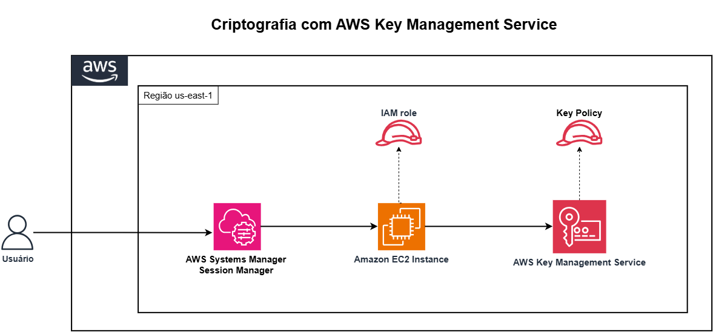

# Arquitetura da Solução

## Diagrama

## Fluxo de Envelope Encryption

## Fluxo de Criptografia Direta

## Decisão: Envelope vs Direta

| Critério | Envelope Encryption | Criptografia Direta |
|----------|-------------------|-------------------|
| Tamanho do arquivo | Qualquer tamanho | Até 4KB |
| Performance | Melhor (criptografia local) | Latência de rede |
| Custo | 1 chamada KMS | 1 chamada KMS por operação |
| Complexidade | Maior (gerenciar data key) | Menor |
| Uso típico | Arquivos, bancos de dados | Senhas, tokens, secrets |

---

## Referências

- [Envelope Encryption - Como funciona](https://docs.aws.amazon.com/kms/latest/developerguide/concepts.html#enveloping)
- [Criptografia direta com KMS (Encrypt API)](https://docs.aws.amazon.com/kms/latest/APIReference/API_Encrypt.html)
- [Decrypt API](https://docs.aws.amazon.com/kms/latest/APIReference/API_Decrypt.html)
- [GenerateDataKey API](https://docs.aws.amazon.com/kms/latest/APIReference/API_GenerateDataKey.html)
