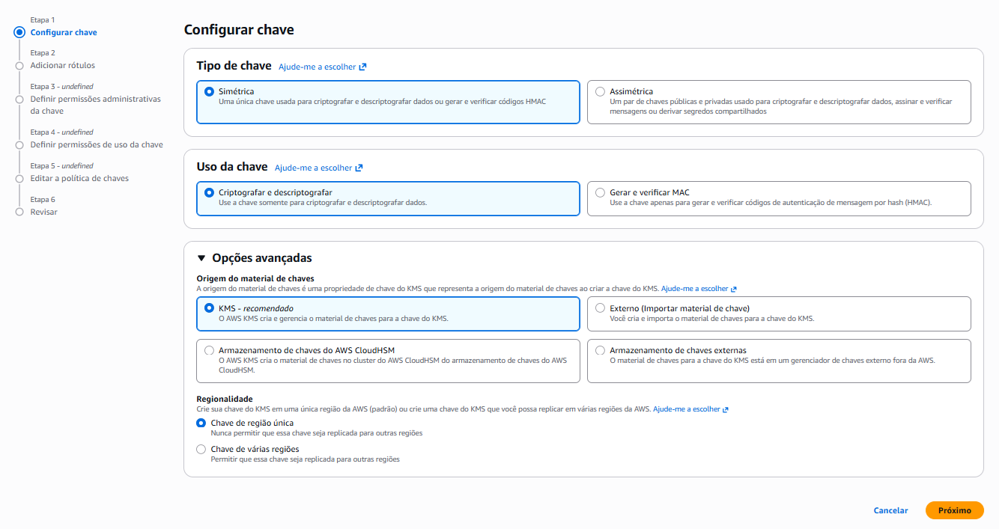
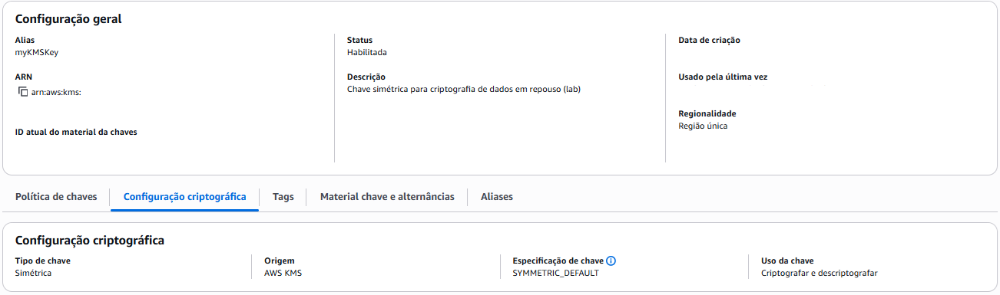

# Criação da Chave KMS

## O Que é o AWS KMS?

O AWS Key Management Service (KMS) é um serviço gerenciado para criação e controle de chaves criptográficas. Ele utiliza módulos de segurança de hardware (HSM) validados pelo FIPS 140-2. O material criptográfico é gerado e permanece dentro do serviço.

## Passo a Passo via Console

### Acessar o Console do KMS

1. Na barra de navegação superior, verificar a região: **us-east-1 (Virgínia do Norte)**
2. Na caixa de pesquisa, digitar: `KMS`
3. Clicar em **Key Management Service (KMS)**
4. Na página inicial do KMS, clicar em **Criar uma chave**

---

### Etapa 1: Configurar chave

Configure o tipo, uso, origem do material e regionalidade:

1. **Tipo de chave**: Simétrica
2. **Uso da chave**: Criptografar e descriptografar
3. Expandir **Opções avançadas**
4. **Origem do material de chaves**: KMS (recomendado)
5. **Regionalidade**: Chave de região única

A chave simétrica foi escolhida porque a mesma entidade executa as duas operações (criptografia e descriptografia). Em cenários onde partes externas participam do processo, chaves assimétricas são mais indicadas.

Quanto a regionalidade, a chave foi configurada para operar em região única. O [projeto 03](../../03-chaves-multi-regiao/) explora a replicação entre regiões para cenários de Disaster Recovery.

---

### Etapa 2: Adicionar rótulos

- **Alias**: `myKMSKey`
- **Descrição**: Chave simétrica para criptografia de dados em repouso (lab)

A descrição ajuda a identificar a finalidade da chave quando existem várias na conta.

---

### Etapa 3: Definir permissões administrativas da chave

1. Na busca de administradores, digitar o nome do seu usuário IAM
2. Selecionar o seu usuário
3. Manter habilitada a opção: **Permitir que administradores de chaves excluam essa chave**

Neste lab, selecionei meu próprio usuário IAM como administrador da chave porque sou a única operadora do ambiente. A role `KMSKeyAdminRole` (criada na [etapa anterior](03-configuracao-iam.md)) existe como boa prática para cenários com múltiplas pessoas ou automações. Em vez de conceder acesso direto a cada indivíduo, a equipe assume a role quando precisa gerenciar chaves.

> **Exclusão de chaves**: mantive ativada para facilitar a remoção dos recursos ao final do laboratório. Em ambientes compartilhados, essa opção pode ser desabilitada como proteção adicional.

---

### Etapa 4: Definir permissões de uso da chave

Esta etapa define quem pode utilizar a chave para operações criptográficas (Encrypt, Decrypt, GenerateDataKey).

1. Na busca, digitar o nome do seu usuário IAM
2. Selecionar o seu usuário

Selecionei o mesmo usuário utilizado na etapa anterior por ser um ambiente de uso pessoal. Em cenários com serviços dedicados, a permissão de uso seria atribuída diretamente à role da instância ou função que executa a criptografia.

> A tela também oferece a opção "Outras contas da AWS", útil para cenários multi-conta com ambientes separados (dev, staging, produção).

---

### Etapa 5: Editar a política de chaves

O console exibe a Key Policy em JSON gerada com base nas configurações anteriores. Revisar e avançar.

---

### Etapa 6: Revisar

Confirmar as configurações e clicar em **Concluir**.

---

### Após a criação

Copiar o **Key ID** exibido na seção "Chaves gerenciadas pelo cliente". Ele será utilizado nos comandos de criptografia das próximas etapas.

---

## Verificações Pós-Criação

- ✅ Status da chave: **Habilitada**
- ✅ Tipo: Simétrica
- ✅ Uso: Criptografar e descriptografar
- ✅ Regionalidade: Região única

---

## Referências

- [Criar chaves KMS](https://docs.aws.amazon.com/kms/latest/developerguide/create-keys.html)
- [Key Policies](https://docs.aws.amazon.com/kms/latest/developerguide/key-policies.html)
- [Aliases do KMS](https://docs.aws.amazon.com/kms/latest/developerguide/kms-alias.html)
- [Tipos de chaves (simétrica vs assimétrica)](https://docs.aws.amazon.com/kms/latest/developerguide/concepts.html#key-spec)
