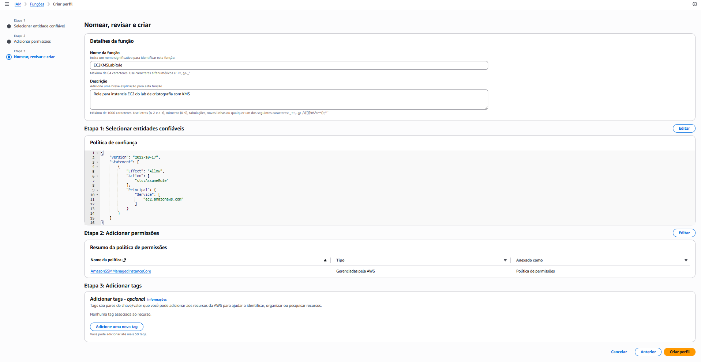
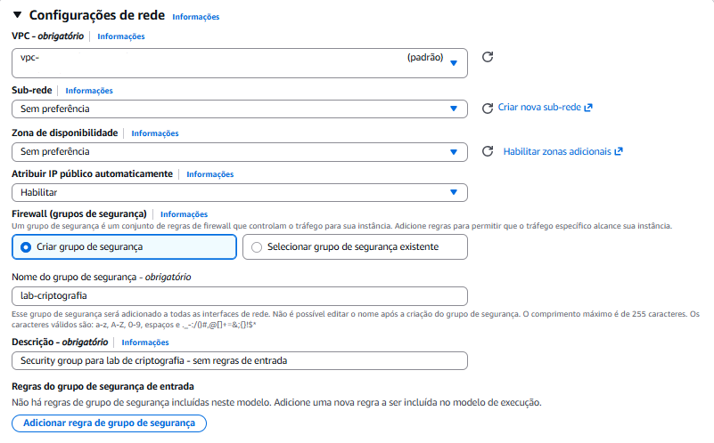
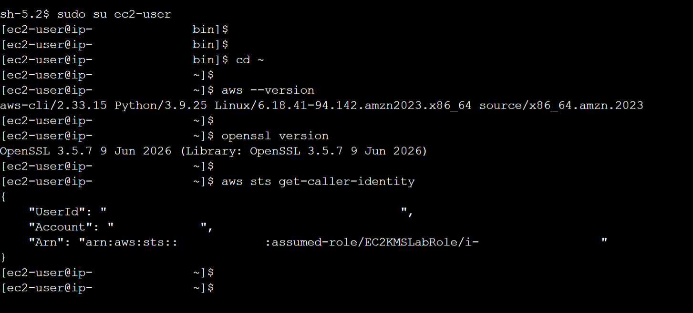

# 🖥️ Criação da Instância EC2

A instância EC2 é o ambiente onde os comandos de criptografia serão executados. O Amazon Linux 2023 foi escolhido porque já inclui a AWS CLI e o OpenSSL, e o acesso via Session Manager permite conectar à instância sem a necessidade de gerenciar chaves SSH ou abrir portas de entrada no Security Group.

---

## Parte 1: Criar a Role da EC2

A instância precisa de uma role IAM para interagir com o KMS e com o Session Manager.

### 1. Acessar o IAM

1. Na barra de pesquisa, digitar: `IAM`
2. Clicar em **IAM**
3. No painel lateral, clicar em **Funções** (Roles)
4. Clicar em **Criar função**

### 2. Configurar a entidade confiável

1. Tipo de entidade confiável: **Serviço da AWS**
2. Caso de uso: **EC2**
3. Clicar em **Avançar**

### 3. Adicionar permissões

1. Na busca de políticas, digitar: `AmazonSSMManagedInstanceCore`
2. Selecionar a política
3. Clicar em **Avançar**

A política `AmazonSSMManagedInstanceCore` habilita a comunicação entre o agente SSM na instância e os endpoints do AWS Systems Manager.

### 4. Nomear e criar a role



1. Nome da função: `EC2KMSLabRole`
2. Descrição: `Role para instancia EC2 do lab de criptografia com KMS`
3. Clicar em **Criar função**

### 5. Adicionar política inline de KMS

1. Na lista de roles, clicar em **EC2KMSLabRole**
2. Aba **Permissões** → clicar em **Adicionar permissões → Criar política em linha**
3. Selecionar a aba **JSON**
4. Colar:

```json
{
  "Version": "2012-10-17",
  "Statement": [
    {
      "Sid": "PermitirOperacoesCriptograficas",
      "Effect": "Allow",
      "Action": [
        "kms:GenerateDataKey",
        "kms:Encrypt",
        "kms:Decrypt"
      ],
      "Resource": "arn:aws:kms:us-east-1:<ACCOUNT_ID>:key/<INSIRA_O_KEY_ID>"
    }
  ]
}
```

5. Substituir `<ACCOUNT_ID>` pelo ID da sua conta e `<INSIRA_O_KEY_ID>` pelo ID da chave `myKMSKey` (copiado na [etapa anterior](04-criacao-chave-kms.md))

> O ID da conta pode ser consultado no canto superior direito do console AWS. Clique no nome do usuário e copie o ID da conta.
6. Clicar em **Avançar**
7. Nome da política: `KMSLabEncryptPolicy`
8. Clicar em **Criar política**

A role `EC2KMSLabRole` agora possui duas políticas:

| Política | Função |
|----------|--------|
| `AmazonSSMManagedInstanceCore` | Comunicação com Session Manager |
| `KMSLabEncryptPolicy` | Permissões mínimas de KMS (GenerateDataKey, Encrypt, Decrypt) |

---

## Parte 2: Criar a Instância EC2

Com a role configurada, a próxima etapa é a criação da instância.

### 1. Acessar o console EC2

1. Na barra de pesquisa, digitar: `EC2`
2. Clicar em **EC2**
3. No painel lateral, clicar em **Instâncias**
4. Clicar em **Executar instância**

### 2. Nome e tags

- Nome: `ec2-lab-criptografia`

### 3. AMI (Imagem de máquina)

- Selecionar: **Amazon Linux 2023 AMI** (Free Tier elegível)

### 4. Tipo de instância

- Selecionar: **t2.micro** (Free Tier)

### 5. Par de chaves (login)

- Selecionar: **Prosseguir sem um par de chaves**

O acesso à instância será feito via Session Manager, que utiliza credenciais temporárias do IAM e registra todas as sessões automaticamente. Por isso, não há necessidade de par de chaves SSH.

### 6. Configurações de rede

Clicar em **Editar** para expandir as configurações de rede.



1. **VPC**: manter a VPC padrão da conta
2. **Sub-rede**: manter a sub-rede padrão (qualquer zona de disponibilidade)
3. **Atribuir IP público automaticamente**: selecionar **Habilitar**
   - O Session Manager precisa que a instância se comunique com os endpoints do AWS Systems Manager. Com IP público, essa comunicação acontece via Internet Gateway.
4. **Firewall (security groups)**: selecionar **Criar security group**
   - Nome: `lab-criptografia`
   - Descrição: `Security group para lab de criptografia - sem regras de entrada`
   - **Remover a regra de entrada SSH (porta 22)** que vem por padrão

      Para remover: clicar no botão **Remover** ao lado da regra de entrada que o console cria automaticamente. O security group deve ficar **sem nenhuma regra de entrada**.

5. Regras de saída: manter o padrão (todo tráfego de saída permitido)

O Session Manager funciona de dentro para fora: o agente SSM na instância inicia a conexão com os endpoints da AWS (tráfego de saída). Por isso, não precisa de portas de entrada abertas.

### 7. Armazenamento

- Manter **8 GB gp3** (padrão)

### 8. Detalhes avançados

- Rolar até o campo **Perfil de instância do IAM**
- Selecionar: **EC2KMSLabRole**

Se a role não aparecer na lista, clicar no botão de atualizar (🔄) ao lado do campo.

### 9. Executar a instância

1. Revisar o resumo das configurações
2. Clicar em **Executar instância**

---

## Parte 3: Verificar o Acesso via Session Manager

1. Aguardar a instância ficar com estado **Executando** e verificações de status **2/2 aprovadas** (pode levar 1-2 minutos)
2. Selecionar a instância `ec2-lab-criptografia`
3. Clicar em **Conectar**
4. Selecionar a aba **Session Manager**
5. Clicar em **Conectar**

Se tudo estiver configurado corretamente, um terminal abre no navegador.

> Para colar comandos no terminal do Session Manager, clique com o botão direito na área do terminal e selecione **Colar**. O atalho Ctrl+V pode não funcionar dependendo do navegador.

```bash
sudo su ec2-user
```

```bash
cd ~
```

Verificar AWS CLI:

```bash
aws --version
```

Verificar OpenSSL:

```bash
openssl version
```

Verificar que a role está ativa:

```bash
aws sts get-caller-identity
```

A saída do `get-caller-identity` deve mostrar a role `EC2KMSLabRole`, confirmando que a instância possui as permissões configuradas.



---

## Resumo dos Recursos Criados

| Recurso | Nome | Função |
|---------|------|--------|
| IAM Role | `EC2KMSLabRole` | Permissões para KMS e Session Manager |
| Política gerenciada | `AmazonSSMManagedInstanceCore` | Comunicação com Session Manager |
| Política inline | `KMSLabEncryptPolicy` | Permissões mínimas de KMS |
| Instância EC2 | `ec2-lab-criptografia` | Ambiente de execução dos comandos |
| Security Group | `lab-criptografia` | Sem regras de entrada |

> Esta instância é reaproveitada nos próximos laboratórios (rotação e multi-região), então vale mantê-la disponível ao final do Lab 01.

## Teste de Menor Privilégio

Com o princípio do menor privilégio aplicado, qualquer ação fora do escopo configurado é negada. A role `EC2KMSLabRole` possui apenas permissões de `kms:GenerateDataKey`, `kms:Encrypt` e `kms:Decrypt`.

Para validar, execute uma operação não permitida pela role (agendar exclusão da chave):

```bash
aws kms schedule-key-deletion --key-id <INSIRA_O_KEY_ID> --region us-east-1
```

> Substituir `<INSIRA_O_KEY_ID>` pelo ID da chave `myKMSKey` (copiado na etapa de criação). Esse comando não aceita alias.

**Resultado esperado:**
```
An error occurred (AccessDeniedException) when calling the ScheduleKeyDeletion operation: User: arn:aws:sts::<ACCOUNT_ID>:assumed-role/EC2KMSLabRole/... is not authorized to perform: kms:ScheduleKeyDeletion
```

✅ Acesso negado. A instância pode criptografar e descriptografar, mas não pode deletar a chave.


---

## Referências

- [Amazon EC2 - Executar instância](https://docs.aws.amazon.com/AWSEC2/latest/UserGuide/EC2_GetStarted.html)
- [Instance Profiles](https://docs.aws.amazon.com/IAM/latest/UserGuide/id_roles_use_switch-role-ec2_instance-profiles.html)
- [AmazonSSMManagedInstanceCore](https://docs.aws.amazon.com/systems-manager/latest/userguide/session-manager-getting-started-instance-profile.html)
- [Security Groups](https://docs.aws.amazon.com/AWSEC2/latest/UserGuide/ec2-security-groups.html)
- [Session Manager - Configuração](https://docs.aws.amazon.com/systems-manager/latest/userguide/session-manager-getting-started.html)
