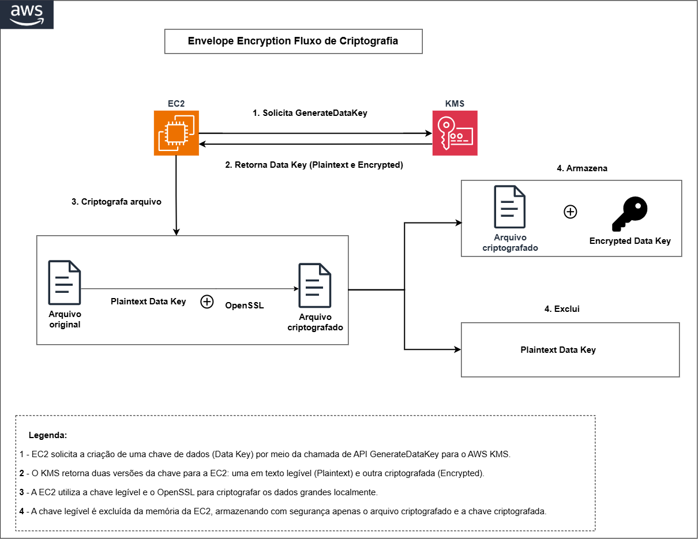
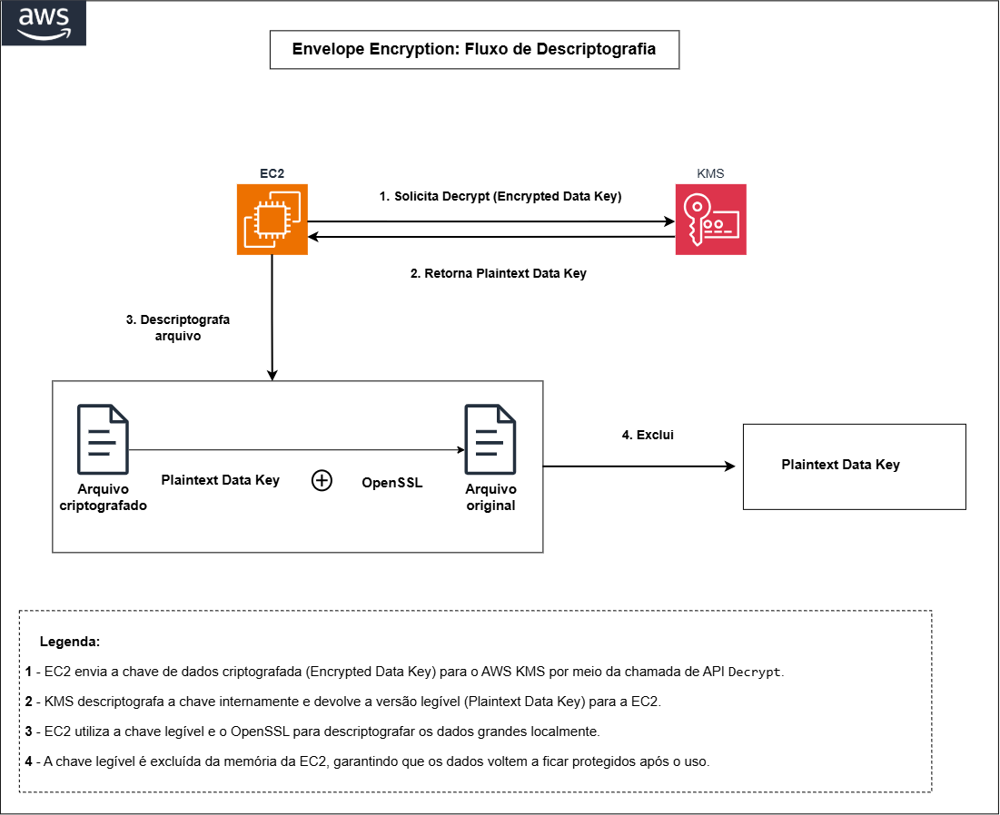
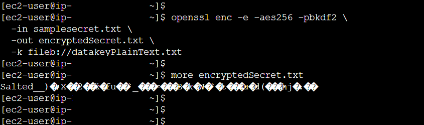

# Envelope Encryption

## O Que É?

A criptografia de envelope (Envelope Encryption) é a prática de criptografar dados com uma **chave de dados** (data key) e depois criptografar essa chave de dados com outra chave (a chave mestre, ou CMK, no KMS). É o método utilizado pelos serviços AWS para criptografar dados via KMS e permite trabalhar com arquivos de qualquer tamanho localmente, sem enviar os dados para o serviço.

---

## Por Que Usar Envelope Encryption?

1. **Performance**: criptografia local é mais rápida que enviar dados pela rede
2. **Sem limite de tamanho**: KMS só aceita até 4KB diretamente; com envelope, qualquer tamanho funciona
3. **Segurança**: a data key nunca é armazenada em texto plano permanentemente
4. **Auditoria**: CloudTrail registra quando a chave é gerada ou descriptografada

---

## Fluxo da Operação

O diagrama abaixo mostra o caminho completo que vamos percorrer no passo a passo:





---

## Passo a Passo

### 1. Conectar à Instância via Session Manager

1. No console EC2, selecionar a instância `ec2-lab-criptografia`
2. Clicar em **Conectar**
3. Selecionar a aba **Session Manager**
4. Clicar em **Conectar**

Após o terminal abrir no navegador:

```bash
sudo su ec2-user
```

```bash
cd ~
```

---

### 2. Criar o Arquivo com Dados Sensíveis

Esse arquivo simula os dados sensíveis que serão protegidos pela criptografia.

```bash
echo "Texto secreto para criptografar." > samplesecret.txt
```

Verificar o conteúdo:

```bash
cat samplesecret.txt
```

**Saída:**
```
Texto secreto para criptografar.
```

---

### 3. Gerar a Data Key via KMS

```bash
aws kms generate-data-key \
  --key-id alias/myKMSKey \
  --key-spec AES_256 \
  --encryption-context project=practice \
  --region us-east-1
```

O parâmetro `--encryption-context` associa um par chave-valor à operação. O mesmo valor deve ser informado no momento da descriptografia.

**Saída (exemplo):**
```json
{
  "CiphertextBlob": "AQIDAHhz...base64...",
  "Plaintext": "abc123...base64...",
  "KeyId": "arn:aws:kms:us-east-1:<ACCOUNT_ID>:key/<KEY_ID>"
}
```

| Campo | Descrição |
|-------|-----------|
| `Plaintext` | Chave de dados em texto plano (base64), usada para criptografar |
| `CiphertextBlob` | Cópia criptografada da chave, armazenada com segurança |
| `KeyId` | ARN da chave KMS que criptografou a data key |

---

### 4. Salvar as Chaves em Arquivos

Os valores são salvos em arquivos separados: a plaintext key para uso imediato e a cópia criptografada para armazenamento seguro.

> **Dica:** Copie os valores de `Plaintext` e `CiphertextBlob` para um bloco de notas antes de colar no terminal. Valores base64 são sensíveis a espaços ou quebras de linha extras.

Salvar a plaintext data key (substituir `VALOR_PLAINTEXT` pelo valor real):

```bash
echo 'VALOR_PLAINTEXT' | base64 --decode > datakeyPlainText.txt
```

**Exemplo:** se a saída do passo 3 retornou `"Plaintext": "SGVsbG8gV29ybGQ="`, o comando seria:

```bash
echo 'SGVsbG8gV29ybGQ=' | base64 --decode > datakeyPlainText.txt
```

Salvar a encrypted data key (substituir `VALOR_CIPHERTEXTBLOB` pelo valor real):

```bash
echo 'VALOR_CIPHERTEXTBLOB' | base64 --decode > datakeyEncrypted.txt
```

---

### 5. Criptografar o Arquivo com OpenSSL

O OpenSSL usa a plaintext key para criptografar o arquivo localmente, sem enviar os dados ao KMS.

```bash
openssl enc -e -aes256 -pbkdf2 \
  -in samplesecret.txt \
  -out encryptedSecret.txt \
  -k fileb://datakeyPlainText.txt
```

Verificar a criptografia:

```bash
more encryptedSecret.txt
```

O conteúdo deve estar ilegível, confirmando que a criptografia funcionou.



---

### 6. Excluir a Plaintext Data Key

```bash
rm datakeyPlainText.txt
```

Após a criptografia, a chave em texto plano (plaintext) é removida. Apenas a cópia criptografada (`datakeyEncrypted.txt`) permanece armazenada. Quando necessário descriptografar, a chave pode ser recuperada via KMS.

---

### 7. Recuperar a Data Key para Descriptografar

Como a plaintext key foi excluída, pedimos ao KMS que a recupere a partir da cópia criptografada.

```bash
aws kms decrypt \
  --encryption-context project=practice \
  --ciphertext-blob fileb://datakeyEncrypted.txt \
  --region us-east-1
```

O encryption context utilizado na criptografia deve ser informado na descriptografia. Caso contrário, a operação retorna erro.

A saída retorna o campo `Plaintext` com a chave recuperada. Copie o valor e salve (substituir `VALOR_PLAINTEXT` pelo valor retornado):

```bash
echo 'VALOR_PLAINTEXT' | base64 --decode > datakeyPlainText.txt
```

---

### 8. Descriptografar o Arquivo

Com a plaintext key recuperada, o OpenSSL descriptografa o arquivo e restaura o conteúdo original.

```bash
openssl enc -d -aes256 -pbkdf2 \
  -in encryptedSecret.txt \
  -k fileb://datakeyPlainText.txt
```

**Saída esperada:**
```
Texto secreto para criptografar.
```

✅ Texto original recuperado com sucesso.


---

## Referências

- [Envelope Encryption - Conceito](https://docs.aws.amazon.com/kms/latest/developerguide/concepts.html#enveloping)
- [GenerateDataKey](https://docs.aws.amazon.com/kms/latest/APIReference/API_GenerateDataKey.html)
- [Decrypt](https://docs.aws.amazon.com/kms/latest/APIReference/API_Decrypt.html)
- [Encryption Context](https://docs.aws.amazon.com/kms/latest/developerguide/concepts.html#encrypt_context)
- [OpenSSL enc](https://www.openssl.org/docs/man3.0/man1/openssl-enc.html)
