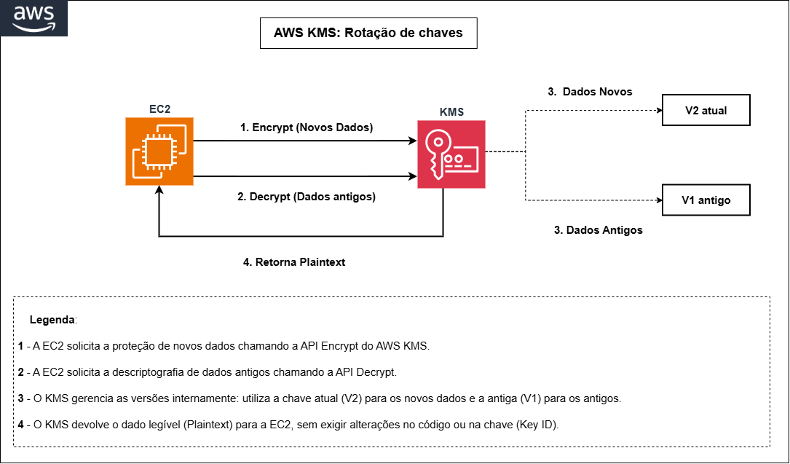
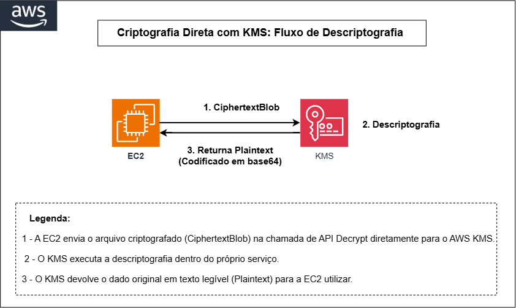
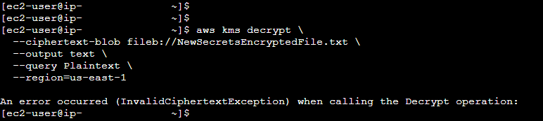
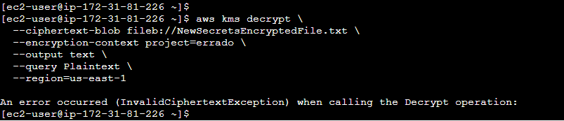
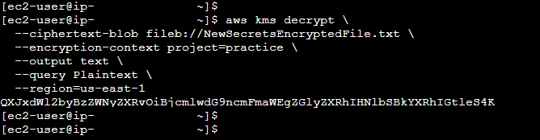
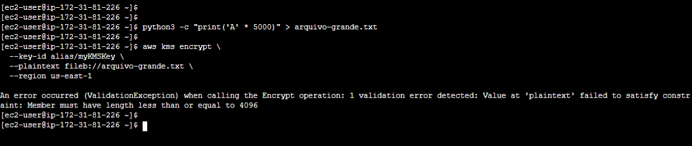

# Criptografia Direta via KMS

## O Que É?

O AWS KMS pode criptografar e descriptografar diretamente (Direct Encryption) até **4 kilobytes (4096 bytes)** de dados, sem a necessidade de gerar uma chave de dados separada. Isso é útil para proteger pequenas informações sensíveis como senhas de banco de dados, tokens de API, identificadores pessoais e chaves de configuração.

---

## Encryption Context

O Encryption Context é um par chave-valor opcional que adiciona uma camada extra de autenticação. O mesmo valor deve ser informado no momento da descriptografia. É registrado no CloudTrail e não é criptografado, então não deve conter dados sensíveis.

Neste laboratório, o valor utilizado é `project=practice`. O passo 6 valida o comportamento em cenários de falha.

---

## Comparação: Direta vs Envelope

| Aspecto | Criptografia Direta | Envelope Encryption |
|---------|:------------------:|:------------------:|
| Limite de tamanho | 4KB | Ilimitado |
| Chamadas ao KMS | A cada operação | Apenas para gerar/recuperar key |
| Dados trafegam pela rede | Sim | Não (criptografia local) |
| Complexidade | Baixa | Média |
| Performance para arquivos grandes | Não aplicável | Melhor |
| Ideal para | Secrets, tokens, senhas | Arquivos, backups, dados |

---

## Fluxo da Operação





---

## Passo a Passo

> Se você seguiu o doc anterior (Envelope Encryption), já está conectado à instância via Session Manager. Caso contrário, conecte-se à instância `ec2-lab-criptografia` via Session Manager e execute `sudo su ec2-user` e `cd ~`.

---

### 1. Criar o Arquivo para Criptografia

```bash
echo "Arquivo secreto: criptografia direta sem data key." > NewSecretFile.txt
```

Verificar o conteúdo:

```bash
cat NewSecretFile.txt
```

**Saída:**
```
Arquivo secreto: criptografia direta sem data key.
```

---

### 2. Criptografar Diretamente com KMS

```bash
aws kms encrypt \
  --key-id alias/myKMSKey \
  --plaintext fileb://NewSecretFile.txt \
  --encryption-context project=practice \
  --output text \
  --query CiphertextBlob \
  --region=us-east-1 | base64 --decode > NewSecretsEncryptedFile.txt
```

Detalhes do comando:

> Os parâmetros seguem a mesma lógica do comando `generate-data-key` ([doc 06](06-envelope-encryption.md)).

---

### 3. Verificar a Criptografia

```bash
cat NewSecretsEncryptedFile.txt
```

O conteúdo deve estar completamente ilegível (dados binários criptografados).

---

### 4. Descriptografar com KMS

```bash
aws kms decrypt \
  --ciphertext-blob fileb://NewSecretsEncryptedFile.txt \
  --encryption-context project=practice \
  --output text \
  --query Plaintext \
  --region=us-east-1 | base64 --decode > NewSecretsDecryptedFile.txt
```

Não é necessário fornecer o `--key-id` na descriptografia. O KMS identifica automaticamente qual chave foi usada pela metadata embutida no ciphertext.

---

### 5. Verificar a Descriptografia

```bash
cat NewSecretsDecryptedFile.txt
```

**Saída esperada:**
```
Arquivo secreto: criptografia direta sem data key.
```

✅ Descriptografia bem-sucedida.

---

### 6. Testar o Encryption Context na Prática

O encryption context foi usado na criptografia (`project=practice`). Agora vamos provar que ele realmente funciona como camada de proteção.

**Teste A: Descriptografar sem encryption context**

```bash
aws kms decrypt \
  --ciphertext-blob fileb://NewSecretsEncryptedFile.txt \
  --output text \
  --query Plaintext \
  --region=us-east-1
```

**Resultado esperado:** Erro `InvalidCiphertextException`



**Teste B: Descriptografar com encryption context errado**

```bash
aws kms decrypt \
  --ciphertext-blob fileb://NewSecretsEncryptedFile.txt \
  --encryption-context project=errado \
  --output text \
  --query Plaintext \
  --region=us-east-1
```

**Resultado esperado:** Mesmo erro `InvalidCiphertextException`



**Teste C: Descriptografar com encryption context correto**

```bash
aws kms decrypt \
  --ciphertext-blob fileb://NewSecretsEncryptedFile.txt \
  --encryption-context project=practice \
  --output text \
  --query Plaintext \
  --region=us-east-1
```

**Resultado esperado:** Retorna o valor em base64 (sucesso).



O KMS não informa se o context está errado ou ausente. A mensagem de erro é a mesma nos dois casos. Isso é intencional: impede que um atacante ajuste tentativas com base no feedback do serviço.

---

### 7. Testar o Limite de 4KB

A operação `Encrypt` do KMS aceita no máximo 4096 bytes. Este teste valida esse comportamento.

Criar um arquivo maior que 4KB:

```bash
python3 -c "print('A' * 5000)" > arquivo-grande.txt
```

Tentar criptografar diretamente:

```bash
aws kms encrypt \
  --key-id alias/myKMSKey \
  --plaintext fileb://arquivo-grande.txt \
  --region us-east-1
```

**Resultado esperado:** Erro `ValidationException`



Para arquivos acima desse limite, a abordagem adequada é o Envelope Encryption ([doc 06](06-envelope-encryption.md)).


---

## Referências

- [Encrypt API](https://docs.aws.amazon.com/kms/latest/APIReference/API_Encrypt.html)
- [Decrypt API](https://docs.aws.amazon.com/kms/latest/APIReference/API_Decrypt.html)
- [Encryption Context](https://docs.aws.amazon.com/kms/latest/developerguide/concepts.html#encrypt_context)
- [Limites do KMS (quotas)](https://docs.aws.amazon.com/kms/latest/developerguide/limits.html)
