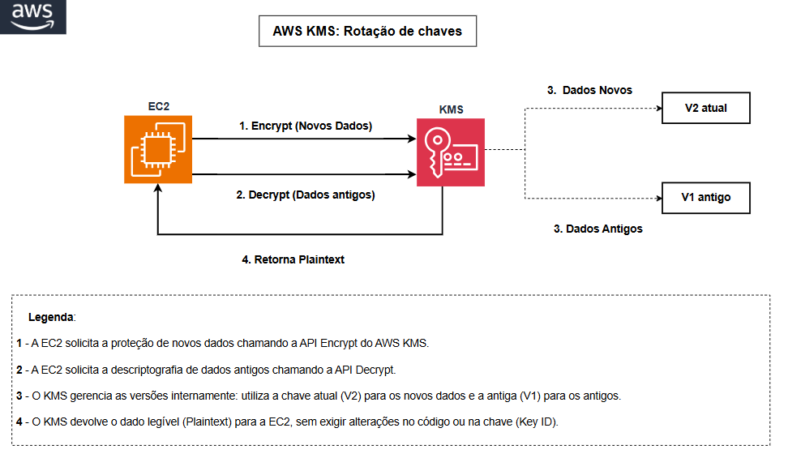

# Rotação de Chaves com AWS KMS

## Sobre o projeto

Neste laboratório, explorei como manter chaves KMS seguras ao longo do tempo através da rotação do material criptográfico.

A prática é uma extensão do [Lab de Criptografia](../01-lab-criptografia/). Depois de criar e usar uma chave KMS, o próximo passo era entender como renovar a proteção sem interromper operações existentes.

A implementação foi feita no console da AWS e via CLI, cobrindo os dois tipos de rotação disponíveis no KMS: a automática e a sob demanda.

A automática gera novo material criptográfico a cada ano, sem intervenção manual. O benefício é atender requisitos de compliance (como PCI-DSS) sem depender de alguém lembrar de rotacionar.

A sob demanda permite forçar uma rotação a qualquer momento. Em situações de suspeita de comprometimento, isso limita a janela de exposição sem precisar desativar a chave.

---

## Problema / Contexto

O uso de chaves criptográficas sem renovação periódica é um problema quando pensamos em proteção de dados sensíveis. Na prática, significa que o mesmo segredo protege todos os dados desde o primeiro dia. Em caso de vazamento, o acesso é total e abrange desde os dados mais antigos até os mais recentes.

---

## Objetivo

Ativar e validar a rotação de chaves KMS (automática e sob demanda), demonstrando que:

1. O KMS gerencia múltiplas versões de material criptográfico de forma transparente
2. Dados criptografados antes da rotação continuam acessíveis
3. É possível forçar uma rotação imediata em situação de emergência
4. Não há necessidade de alterar código ou configurações nas aplicações existentes

---

## O que foi implementado

Durante a implementação, foram realizadas as seguintes etapas:

* Ativação da rotação automática anual na chave `myKMSKey` (criada no Lab 01)
* Execução de rotação sob demanda para validação imediata
* Teste de descriptografia de dados criptografados antes da rotação
* Verificação de que o Key ID, ARN e alias permanecem inalterados
* Validação do ciclo completo (encrypt/decrypt) com material pós-rotação
* Consulta ao histórico de rotações via CLI

---

## Tecnologias e serviços utilizados

| Serviço / Ferramenta | Função no projeto |
|----------------------|-------------------|
| AWS KMS | Rotação automática e sob demanda do material criptográfico |
| AWS IAM | Controle de acesso às operações de rotação |
| AWS CLI | Execução das operações de rotação e verificação |
| AWS CloudTrail | Registro de eventos de rotação para auditoria |

---

## Arquitetura

A rotação não cria uma chave nova. Ela apenas troca o segredo interno, mantendo a mesma identidade da chave (mesmo Key ID, mesmo ARN). O KMS mantém todas as versões anteriores do material para garantir compatibilidade retroativa com dados já criptografados.

---

## Documentação

A documentação foi dividida em etapas para facilitar o acompanhamento da implementação:

| # | Documento | Descrição |
|---|-----------|-----------|
| 1 |  [Cenário do laboratório](docs/01-cenario.md) | Contexto e problema abordado |
| 2 |  [Arquitetura da solução](docs/02-arquitetura.md) | Como funciona a rotação internamente |
| 3 | [Passo a passo](docs/03-passo-a-passo.md) | Ativação e execução da rotação |
| 4 | [Testes e validação](docs/04-testes.md) | Validações pré e pós rotação |
| 5 |  [Lições aprendidas](docs/05-licoes-aprendidas.md) | Troubleshooting e principais aprendizados |

> Este laboratório também pode ser reproduzido inteiramente via AWS CLI. Consulte o [guia via CLI](lab-via-cli.md).

---

##  Investimento

| Recurso | Custo estimado |
|---------|---------------|
| Chave KMS (armazenamento mensal) | ~$1.00/mês |
| Rotação automática | Incluído no custo da chave |
| Rotação sob demanda | $1.00 por rotação |
| Requests (encrypt/decrypt) | $0.03 por 10.000 requisições |
| **Total estimado** | **~$1.00/mês (operação normal)** |

> A rotação automática não gera custo adicional. Apenas rotações sob demanda têm cobrança individual.

---

## Resultados

Ao final do laboratório, foi possível:

* Ativar a rotação automática anual com sucesso
* Confirmar que dados criptografados antes da rotação continuam acessíveis
* Executar e validar uma rotação sob demanda
* Verificar que o Key ID, ARN e alias permanecem inalterados após a rotação
* Validar que as aplicações continuam funcionando sem alteração de código ou configuração
* Consultar o histórico completo de rotações via CLI

---

## Autora

**Melina França** —  AWS Developer Associate

---

⬅️ [Voltar ao repositório principal](../README.md)
