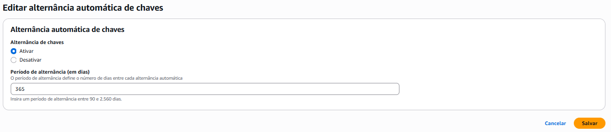
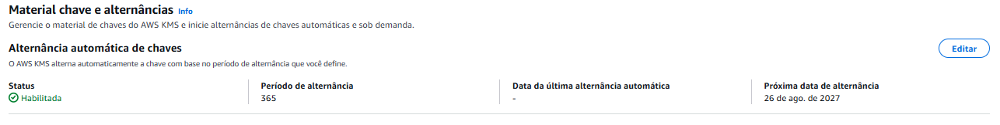
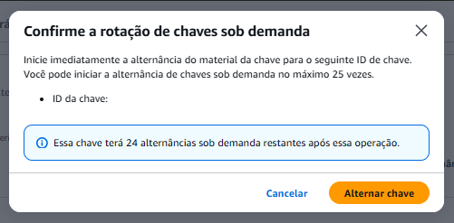
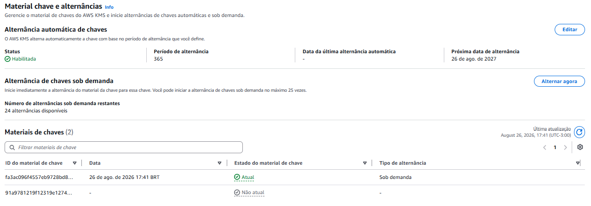
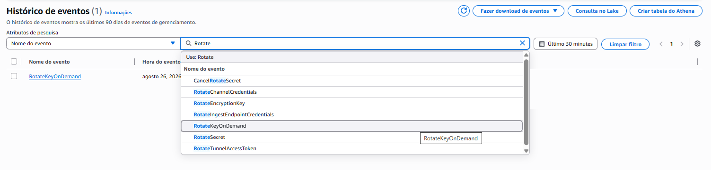

# 🔄 Passo a Passo: Rotação de Chaves

Este documento cobre a ativação e a validação da rotação de chaves pelo **console da AWS**. Os mesmos passos podem ser reproduzidos via linha de comando: consulte o [guia via CLI](../lab-via-cli.md).

A chave utilizada (`myKMSKey`) foi criada no [Lab de Criptografia](../../01-lab-criptografia/).

> No console em português, "rotação" aparece como **alternância**. Neste documento, uso "rotação" no texto e o termo do console em negrito quando for necessário localizar um botão na tela.

---

## Parte 1: Ativação da Rotação Automática

### Acessar a aba de rotação

1. Acessar **KMS → Chaves gerenciadas pelo cliente**
2. Clicar na chave `myKMSKey`
3. Selecionar a aba **Material chave e alternâncias**

Nessa aba, o console mostra a seção **Alternância automática de chaves** com o status atual (inicialmente **Desabilitada**).

---

### Ativar a rotação

1. Na seção **Alternância automática de chaves**, clicar em **Editar**
2. Selecionar **Ativar**
3. Manter o **Período de alternância (em dias)** em `365` (padrão)
4. Clicar em **Salvar**

> O período pode ser definido entre **90 e 2.560 dias**. Mantive o padrão de 365 dias, que corresponde à rotação anual recomendada pela AWS.

---

### Confirmar a ativação

Após salvar, a seção **Alternância automática de chaves** passa a exibir o status **Habilitada**, o período configurado e a **próxima data de alternância**.

No meu caso, ao ativar a rotação, a próxima rotação automática ficou agendada para **um ano depois** (365 dias). A data da última alternância aparece vazia, pois a chave ainda não passou por nenhuma rotação automática.

---

## Parte 2: Rotação Sob Demanda

A rotação sob demanda gera novo material criptográfico imediatamente, sem esperar o ciclo automático. É útil para validar o processo ou em situações de suspeita de comprometimento.

### Executar a rotação

1. Na aba **Material chave e alternâncias**, localizar a seção **Alternância de chaves sob demanda**
2. Clicar em **Alternar agora**
3. Conferir os dados no modal de confirmação e clicar em **Alternar chave**

> A AWS permite no máximo **25 rotações sob demanda** por chave. O modal informa quantas restarão após a operação: no meu caso, a chave passou a ter **24 rotações disponíveis**.

---

### Confirmar o novo material

Antes da rotação, a tabela **Materiais de chaves** listava apenas 1 material (o de criação). Após a rotação sob demanda, ela passa a listar **2 materiais**:

- O material mais recente aparece como **Atual**, com a data da rotação e o tipo **Sob demanda**
- O material original passa a **Não atual**, mas permanece disponível para descriptografar dados criptografados antes da rotação

Esse é o ponto central da rotação: o material antigo não é descartado. É essa convivência entre versões que garante a compatibilidade retroativa.

---

## Parte 3: Validação Pós-Rotação

O teste mais importante é confirmar que dados criptografados antes da rotação continuam acessíveis. Essa validação está documentada em detalhe no doc de [testes](04-testes.md).

---

## Parte 4: Monitoramento

### Verificar a rotação no CloudTrail

A rotação de chave é registrada no CloudTrail, o que permite auditar a operação realizada.

1. Acessar **CloudTrail → Histórico de eventos**
2. Em **Atributos de pesquisa**, filtrar por: Nome do evento (Event name) = `RotateKeyOnDemand`
3. Localizar o evento na lista e conferir data e hora

4. Clicar no evento `RotateKeyOnDemand` para abrir a página de detalhes

Na seção **Registro de eventos**, o CloudTrail exibe um documento JSON com os dados completos da operação:

| Campo | O que indica |
|-------|--------------|
| Hora do evento | Quando a rotação foi executada |
| Nome do usuário | Qual identidade IAM disparou a ação |
| Origem do evento | `kms.amazonaws.com` |
| Recursos referenciados | O ARN e o Key ID da chave rotacionada |
| Somente leitura | `false`, já que a rotação altera o estado da chave |

### Monitoramento

Para acompanhar a rotação de chaves em tempo real, é possível criar métricas com o CloudWatch Logs Metric Filter ou capturar o evento pelo EventBridge, disparando uma notificação via SNS. Os trade-offs entre essas abordagens são explorados no [lab de monitoramento de rotação](../../04-monitoramento-rotacao/).

---

## Referências

- [Rotating AWS KMS Keys](https://docs.aws.amazon.com/kms/latest/developerguide/rotate-keys.html)
- [On-demand Key Rotation](https://docs.aws.amazon.com/kms/latest/developerguide/rotate-keys-on-demand.html)
- [Monitoring Key Rotation](https://docs.aws.amazon.com/kms/latest/developerguide/rotate-keys.html#rotate-keys-how-it-works)

