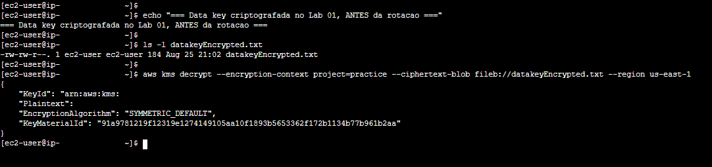
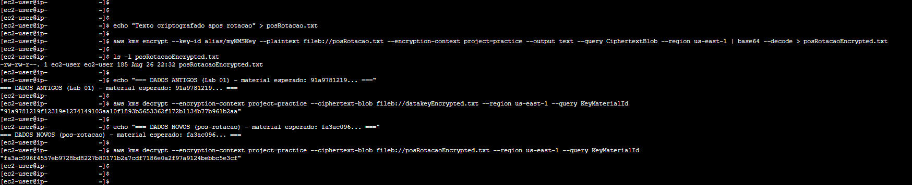

# 🧪 Testes e Validação

Por meio dos testes, avaliamos que os dados criptografados antes da renovação continuam acessíveis e que o KMS escolhe o material correto para cada operação. Eles foram executados via CLI, na instância `ec2-lab-criptografia`, acessada via Session Manager. Para a validação, utilizei os arquivos criados e criptografados no Lab 01.

> Para reproduzir o laboratório inteiro pela linha de comando, consulte o [guia via CLI](../lab-via-cli.md).

---

## Teste 1: Descriptografia de Dados Antigos

O arquivo `datakeyEncrypted.txt` foi criado no Lab 01 (25 de agosto), antes da rotação de hoje (26 de agosto). Se ele continua sendo descriptografável, é porque o KMS preservou o material usado na sua criação.

```bash
aws kms decrypt \
  --encryption-context project=practice \
  --ciphertext-blob fileb://datakeyEncrypted.txt \
  --region us-east-1
```



A operação retornou a data key normalmente. O campo `KeyMaterialId` revela qual versão foi usada: o valor termina em `...b961b2aa`, o mesmo material marcado como **Não atual** no console (o de criação).

**Resultado:** ✅ Dados anteriores à rotação continuam acessíveis, descriptografados com o material original.

---

## Teste 2: Ciclo Completo Pós-Rotação

Após a rotação, a chave passou a ter dois materiais. Este teste mostra qual deles o KMS usa para o dado antigo e para o dado novo. Para isso, criei e criptografei um arquivo novo com a chave rotacionada:

```bash
echo "Texto criptografado apos rotacao" > posRotacao.txt
```

```bash
aws kms encrypt \
  --key-id alias/myKMSKey \
  --plaintext fileb://posRotacao.txt \
  --encryption-context project=practice \
  --output text --query CiphertextBlob \
  --region us-east-1 | base64 --decode > posRotacaoEncrypted.txt
```

Depois, descriptografei os dois arquivos consultando apenas o `KeyMaterialId`, para ver qual versão do material cada um usa:

```bash
aws kms decrypt \
  --encryption-context project=practice \
  --ciphertext-blob fileb://datakeyEncrypted.txt \
  --region us-east-1 --query KeyMaterialId
```

```bash
aws kms decrypt \
  --encryption-context project=practice \
  --ciphertext-blob fileb://posRotacaoEncrypted.txt \
  --region us-east-1 --query KeyMaterialId
```



Os dois materiais são diferentes, e cada um corresponde ao esperado:

| Origem do dado | `KeyMaterialId` | Material |
|----------------|-----------------|----------|
| Dados antigos (Lab 01) | `91a9781219...b961b2aa` | Não atual |
| Dados novos (pós-rotação) | `fa3ac096...bebbc5e3cf` | Atual |

**Resultado:** ✅ O KMS aplica o material recente aos dados novos e mantém o antigo para os dados já criptografados, sem nenhuma intervenção.
