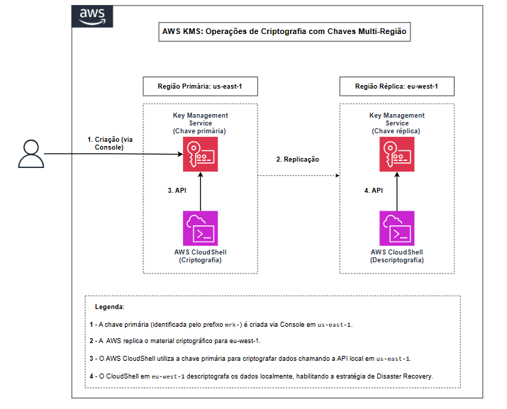

# Chaves Multi-Região com AWS KMS

## Sobre o projeto

Neste laboratório, aprendi como o AWS KMS permite acessar dados criptografados em mais de uma região sem precisar descriptografar e re-criptografar tudo a cada troca de região.

Este é o terceiro passo de uma jornada com o KMS: depois de proteger dados no [Lab 01](../01-lab-criptografia/) e rotacionar chaves no [Lab 02](../02-rotacao-de-chaves/), o foco agora é a disponibilidade das chaves entre regiões.

A criação e a replicação da chave foram feitas no console da AWS, e as operações de criptografia via AWS CloudShell. Usei as duas vias para validar e documentar cada etapa.

---

## O desafio

Quando uma organização opera em múltiplas regiões, dados criptografados em uma região não podem ser lidos em outra com chaves de região única. O caminho tradicional (descriptografar na origem, transferir em texto plano e re-criptografar no destino) é inseguro e depende justamente da região que pode estar indisponível em um cenário de Disaster Recovery.

O desafio foi usar chaves multi-região do AWS KMS para eliminar essa dependência, permitindo que o mesmo material criptográfico esteja disponível em mais de uma região.

---

## Objetivo

Criar uma chave multi-região, replicá-la para uma segunda região e validar que:

1. Dados criptografados em uma região são descriptografados em outra diretamente
2. Não há transferência de texto plano entre regiões
3. O fluxo funciona nos dois sentidos (bidirecional)
4. O Encryption Context é exigido independente da região

---

## O que foi implementado

* Criação da chave primária multi-região em `us-east-1` (console)
* Replicação da chave para `eu-west-1` (Irlanda)
* Criptografia e descriptografia de um arquivo entre as duas regiões (CloudShell)
* Teste do fluxo bidirecional (criptografar na réplica, descriptografar na primária)
* Validação do Encryption Context entre regiões

---

## Tecnologias e serviços utilizados

| Serviço / Ferramenta | Função no projeto |
|----------------------|-------------------|
| AWS KMS | Criação e replicação de chaves multi-região |
| AWS IAM | Controle de acesso às operações do KMS em ambas as regiões |
| AWS CloudShell | Ambiente para executar os comandos da AWS CLI |

---

## Arquitetura

A chave primária em `us-east-1` e a réplica em `eu-west-1` compartilham o mesmo material criptográfico. O CloudShell executa a criptografia na primária e a descriptografia na réplica, sem transferir texto plano entre as regiões.

---

## Documentação

A documentação foi dividida em etapas para facilitar o acompanhamento da implementação:

| # | Documento | Descrição |
|---|-----------|-----------|
| 1 | [Cenário do laboratório](docs/01-cenario.md) | Contexto e problema abordado |
| 2 | [Arquitetura da solução](docs/02-arquitetura.md) | Como funciona a replicação |
| 3 | [Passo a passo](docs/03-passo-a-passo.md) | Criação e replicação pelo console |
| 4 | [Testes e validação](docs/04-testes.md) | Fluxo bidirecional e Encryption Context |
| 5 | [Lições aprendidas](docs/05-licoes-aprendidas.md) | Descobertas e limitações |

> A parte de criptografia entre regiões é feita via linha de comando. Consulte o [guia via CLI](lab-via-cli.md).

> A remoção dos recursos está documentada no [guia de remoção](../REMOCAO-RECURSOS.md) do repositório principal.

---

## Investimento

| Recurso | Custo estimado |
|---------|---------------|
| Chave primária (us-east-1) | ~$1.00/mês |
| Chave réplica (eu-west-1) | ~$1.00/mês |
| Requests (encrypt/decrypt) | $0.03 por 10.000 requisições |
| **Total estimado** | **~$2.00/mês** |

> Para cenários sem necessidade de multi-região, uma chave de região única é mais simples e econômica (metade do custo mensal em chaves).

---

## Resultados

Ao final do laboratório, foi possível:

* Criar e replicar uma chave multi-região entre `us-east-1` e `eu-west-1`
* Criptografar um arquivo em uma região e descriptografá-lo na outra, sem transferir texto plano
* Confirmar o fluxo bidirecional entre primária e réplica
* Validar que o Encryption Context é exigido independente da região

Na prática, o projeto mostrou como o KMS resolve o acesso a dados criptografados entre regiões, um pilar para estratégias de Disaster Recovery.

---

## Autora

**Melina França** —  AWS Developer Associate

---

⬅️ [Voltar ao repositório principal](../README.md)
