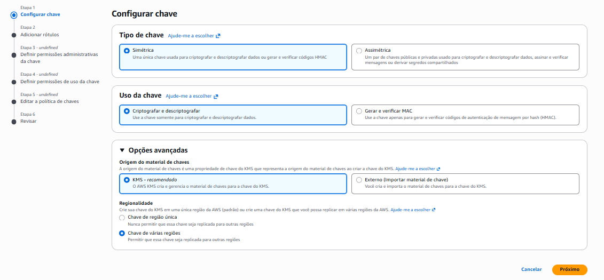
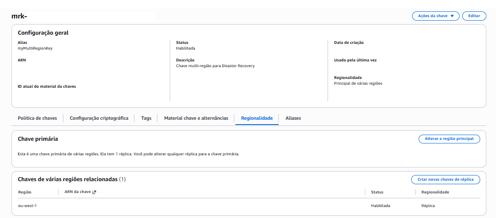

# Passo a Passo: Chaves Multi-Região

Este documento cobre a criação e a replicação de uma chave multi-região pelo **console da AWS**. A criptografia de dados entre as regiões é feita via CLI e está no [guia via CLI](../lab-via-cli.md).

O laboratório usa duas regiões: `us-east-1` (Virgínia do Norte) como primária e `eu-west-1` (Irlanda) como réplica.

> No console em português, a chave multi-região aparece como **Chave de várias regiões**. Neste documento, uso "multi-região" no texto e o termo do console em negrito quando for necessário localizar uma opção na tela.

---

## Nomes Sugeridos

Para acompanhar o passo a passo, sugiro os nomes abaixo. Sinta-se à vontade para adaptá-los, mas mantê-los facilita seguir o restante da documentação.

| Recurso | Nome sugerido | Onde |
|---------|---------------|------|
| Alias da chave primária | `alias/myMultiRegionKey` | us-east-1 |
| Alias da réplica | `alias/myMultiRegionKey` | eu-west-1 |
| Descrição da chave | `Chave multi-região para Disaster Recovery` | ambas |

---

## Parte 1: Criação da Chave Primária

### Iniciar a criação da chave

1. Acessar **KMS → Chaves gerenciadas pelo cliente** (na região `us-east-1`)
2. Clicar em **Criar uma chave**
3. Tipo de chave: **Simétrica**
4. Uso da chave: **Criptografar e descriptografar**

---

### Definir a Regionalidade

1. Expandir **Opções avançadas**
2. Em **Regionalidade**, selecionar **Chave de várias regiões**
3. Clicar em **Próximo**

> Atenção a esta etapa: o padrão do console é **Chave de região única**. Para este laboratório, é preciso mudar para **Chave de várias regiões**. É essa opção que diferencia a chave: uma vez criada como de várias regiões, ela se torna a primária e passa a poder gerar réplicas. A regionalidade não pode ser alterada depois, então uma escolha incorreta aqui exige recriar a chave.

---

### Configurar alias e permissões

1. Alias: `myMultiRegionKey`
2. Descrição: `Chave multi-região para Disaster Recovery`
3. Definir os administradores da chave
4. Definir os usuários da chave (uso criptográfico)
5. Revisar e clicar em **Concluir**

> Mantive o mesmo critério de permissões dos labs anteriores. Como administrador da chave, selecionei meu próprio usuário IAM, por ser a única operadora deste ambiente. A role `KMSKeyAdminRole` (criada no [Lab 01](../../01-lab-criptografia/docs/03-configuracao-iam.md)) segue como a opção recomendada para cenários com múltiplas pessoas ou automações, em que a equipe assume a role em vez de receber acesso individual. Para o uso criptográfico da chave, defini o mesmo usuário, já que é um ambiente pessoal. Em cenários com serviços dedicados, essa permissão de uso iria direto para a role da aplicação que executa a criptografia.

---

### Confirmar a criação

Após concluir, a chave aparece na lista de **Chaves gerenciadas pelo cliente**. O Key ID vem com o prefixo `mrk-`, que identifica chaves multi-região.

> No meu caso, o Key ID da primária começou com o prefixo `mrk-` (por exemplo, `mrk-1234abcd5678efgh9012ijkl3456mnop`). Chaves de região única usam o formato UUID padrão, sem o prefixo `mrk-`, então dá para identificar o tipo da chave só de olhar o ID.

---

## Parte 2: Replicação para eu-west-1

Somente a chave primária pode gerar réplicas. Por isso, a replicação é iniciada a partir dela, na aba **Regionalidade**.

### Acessar a aba de regionalidade

1. Na região `us-east-1`, clicar na chave `myMultiRegionKey`
2. Selecionar a aba **Regionalidade**

---

### Criar a réplica

O console conduz a criação da réplica pelas mesmas etapas da chave primária: rótulos, administradores, usuários, política e revisão.

1. Clicar em **Criar novas chaves de réplica** e selecionar a região de destino: **Europa (Irlanda) eu-west-1**
2. Em **Adicionar rótulos**, confirmar o alias `myMultiRegionKey` e a descrição (o console já traz os dois preenchidos com os valores da primária)
3. Em **Definir as permissões administrativas da chave**, selecionar o administrador
4. Em **Definir as permissões de uso da chave de réplica**, selecionar o usuário
5. Revisar a política e clicar em **Concluir**

> Defini o mesmo usuário como administrador e como usuário da réplica, por ser um ambiente pessoal, seguindo o critério da primária. As duas chaves compartilham o material criptográfico, mas cada região tem administradores, usuários e Key Policy próprios. O próprio console avisa nesse ponto que não sincroniza alterações desses campos entre as regiões: cada chave é independente dali em diante.

---

### Confirmar a réplica

De volta à aba **Regionalidade** da chave primária (em `us-east-1`), a seção **Chaves de várias regiões relacionadas** agora lista a réplica: região `eu-west-1`, com status **Habilitada** e regionalidade **Réplica**.

> Pelo console, o alias já foi definido durante a criação da réplica (na etapa **Adicionar rótulos**), então a réplica em `eu-west-1` já nasceu com o alias `myMultiRegionKey`. Via CLI o comportamento é diferente: o `replicate-key` não cria o alias, e ele precisa ser criado à parte na segunda região. Esse detalhe está no [guia via CLI](../lab-via-cli.md).

---

## Criptografia de dados entre regiões

O [guia via CLI](../lab-via-cli.md) cobre a criptografia em `us-east-1`, na chave primária, e a descriptografia em `eu-west-1`, na réplica.

Optei pelo **AWS CloudShell** para permitir independência entre os labs. Além disso, para alternar entre regiões no CloudShell, basta alterar o parâmetro `--region`.

As validações completas (fluxo bidirecional e comportamento do Encryption Context entre regiões) estão no doc de [testes](04-testes.md).

---

## Referências

- [Multi-Region Keys in AWS KMS](https://docs.aws.amazon.com/kms/latest/developerguide/multi-region-keys-overview.html)
- [Creating Multi-Region Keys](https://docs.aws.amazon.com/kms/latest/developerguide/multi-region-keys-create.html)
- [Replicating Multi-Region Keys](https://docs.aws.amazon.com/kms/latest/developerguide/multi-region-keys-replicate.html)
