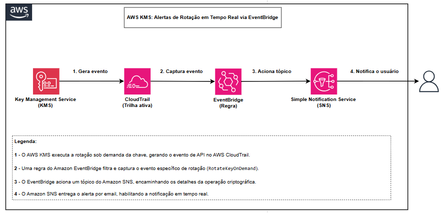
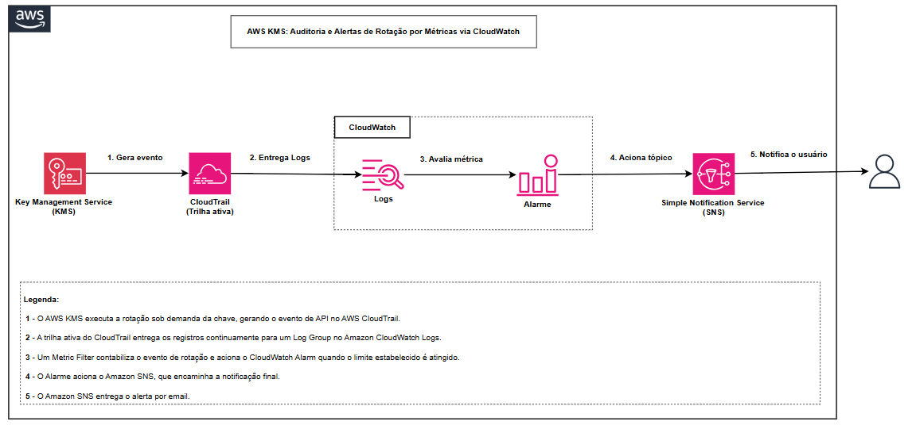

# 🏗️ Arquitetura da Solução

## O Que É?

Quando uma chave é rotacionada, o AWS KMS registra essa operação como um evento de gerenciamento no AWS CloudTrail. A partir desse registro, o evento pode ser monitorado e encaminhado para diferentes serviços da AWS.

Neste laboratório, foram implementados dois caminhos. No primeiro, o **Amazon EventBridge** identifica o evento de rotação e o encaminha para um tópico do **Amazon SNS**, que envia uma notificação por email quase em tempo real. No segundo, o **CloudWatch** contabiliza as ocorrências do evento por meio de um *metric filter* e utiliza essa métrica para disparar um alarme quando um determinado limite é atingido.

A proposta é mostrar como o mesmo evento pode ser utilizado de formas diferentes, de acordo com o objetivo do monitoramento.

## A Fonte dos Eventos: CloudTrail

Os dois caminhos partem do mesmo ponto: uma **trilha do AWS CloudTrail** ativa.

O CloudTrail registra a operação de rotação (`RotateKeyOnDemand`) como um evento de gerenciamento. Essa trilha é responsável por disponibilizar o registro para os serviços que participam dos dois fluxos.

Um detalhe importante é a diferença entre o **Event history** e uma trilha configurada. O Event history permite consultar os eventos registrados pelo CloudTrail, mas essa visualização, por si só, não entrega os eventos para outros serviços. Para que o EventBridge ou o CloudWatch utilizem esses registros em um fluxo de monitoramento, é necessário ter uma **trilha configurada**.

A partir dessa mesma origem, o laboratório segue por dois caminhos:

### Caminho 1: EventBridge + SNS

```
Rotação → CloudTrail → EventBridge (regra) → SNS → Email
```

Uma regra do EventBridge filtra o evento `RotateKeyOnDemand` e o encaminha para um tópico SNS, que realiza a entrega por email.

> **Quando usar:** quando a prioridade é reagir a um evento específico, gerar uma notificação imediata ou iniciar uma ação automaticamente.



### Caminho 2: CloudWatch Metric Filter + Alarme

```
Rotação → CloudTrail → Log Group → Metric Filter → Métrica → Alarme → SNS → Email
```

Nesse fluxo, a trilha do CloudTrail entrega os logs para um **Log Group do CloudWatch**. Um *metric filter* identifica o evento de rotação e transforma suas ocorrências em uma métrica. A partir dela, um alarme pode ser configurado para disparar quando um determinado limite for atingido.

> **Quando usar:** quando a prioridade é acompanhar quantidade, frequência ou tendência dos eventos e gerar alertas com base em um limite.



---

## Comparação dos Dois Caminhos

Os dois caminhos utilizam o mesmo evento de origem, mas tratam esse evento de maneiras diferentes. O **EventBridge** trabalha com o evento individual, permitindo reagir assim que ele ocorre. Já o **CloudWatch** transforma as ocorrências em uma métrica, permitindo acompanhar quantidade e frequência ao longo do tempo e estabelecer limites para alertas.

| Critério | Caminho 1 (EventBridge + SNS) | Caminho 2 (CloudWatch + Alarme) |
| ------------------------ | ---------------------------------------------- | ---------------------------------------------------------------- |
| **Objetivo principal** | Reagir a um evento específico | Monitorar ocorrências e gerar alertas por limite |
| **Latência** | Quase em tempo real | Maior, devido à transformação em métrica e à avaliação do alarme |
| **Configuração** | Regra + destino | Log Group + filtro + métrica + alarme |
| **Tratamento do evento** | Evento a evento | Ocorrências contabilizadas em uma métrica |
| **Threshold** | Não é o foco deste fluxo | Permite definir limites para disparo |
| **Métrica** | Não gera métrica neste fluxo | Sim |
| **Dashboard** | Não é utilizado neste fluxo | Pode ser acompanhado no CloudWatch |
| **Custo** | Relacionado ao roteamento dos eventos e ao SNS | Envolve ingestão/armazenamento de logs e métricas |
| **Melhor para** | Notificações e ações imediatas | Contagem, tendência e alertas baseados em volume |

Na prática, os dois caminhos foram testados a partir da mesma rotação. A notificação do **Caminho 1** chegou quase imediatamente após o evento, enquanto o **Caminho 2** levou cerca de 2,5 minutos para disparar o alarme. Essa diferença está relacionada ao processamento do evento como métrica e à janela utilizada na avaliação do alarme.

> **Cada abordagem atende a um propósito:** o EventBridge é mais adequado quando o objetivo é reagir a um evento específico. O CloudWatch se destaca quando é necessário acompanhar ocorrências ao longo do tempo e estabelecer condições para alertas. Em um ambiente real, os dois podem coexistir e complementar o monitoramento.

---

## Filtrando o Evento Certo

Para que o monitoramento seja útil, tanto a regra do EventBridge quanto o *metric filter* precisam identificar o evento específico de rotação.

Sem esse filtro, o fluxo pode considerar outros eventos registrados pelo CloudTrail, gerando ruído e dificultando a identificação do que realmente importa.

Neste laboratório, são considerados dois tipos de evento relacionados à rotação:

* **Rotação sob demanda:** `RotateKeyOnDemand`, gerado por uma chamada de API e acionado manualmente durante os testes.
* **Rotação automática:** `RotateKey`, gerado pelo processo de rotação automática da chave e capturável pelo tipo dedicado **KMS CMK Rotation** no EventBridge.

O laboratório utiliza o `RotateKeyOnDemand` porque ele permite provocar a rotação no momento do teste e validar os dois fluxos de monitoramento sem precisar aguardar a próxima rotação automática.

---

## Referências

- [Monitor KMS keys with Amazon EventBridge](https://docs.aws.amazon.com/kms/latest/developerguide/kms-events.html)
- [CloudTrail log entry for RotateKeyOnDemand](https://docs.aws.amazon.com/kms/latest/developerguide/ct-rotatekeyondemand.html)
- [CloudWatch Logs metric filters](https://docs.aws.amazon.com/AmazonCloudWatch/latest/logs/MonitoringLogData.html)
