# 🔔 Passo a Passo: Monitoramento de Rotação

Este documento cobre a configuração do monitoramento de rotação de chaves KMS pelo **console da AWS**. Os mesmos passos podem ser reproduzidos via linha de comando: consulte o [guia via CLI](../lab-via-cli.md).

O laboratório monitora a rotação de uma chave dedicada por dois caminhos independentes, para comparar as abordagens:

- **Alertas em Tempo Real com EventBridge (Caminho 1):** captura o evento de rotação e envia uma notificação por email.
- **Auditoria e Alertas por Métricas com CloudWatch (Caminho 2):** conta as rotações a partir dos logs e dispara um alarme.

---

## Nomes Sugeridos

| Recurso | Nome sugerido | Caminho |
|---------|---------------|---------|
| Chave KMS (alias) | `alias/rotationMonitorKey` | ambos |
| Descrição da chave | `Chave para o laboratório de monitoramento de rotação` | ambos |
| Trilha do CloudTrail | `kms-rotation-trail` | ambos |
| Log Group | `aws-cloudtrail-logs-kms-rotation` | ambos |
| Regra do EventBridge | `kms-rotation-monitor-rule` | 1 |
| Tópico SNS | `kms-rotation-alerts` | 1 |
| Metric Filter | `kms-rotation-filter` | 2 |
| Métrica | `KMSKeyRotationCount` | 2 |
| Alarme | `kms-rotation-alarm` | 2 |

---

## Parte 1: Criação da Chave Monitorada

A chave é criada só para este laboratório, isolando o monitoramento do histórico de outras chaves da conta.

### Criar a chave

1. Acessar **KMS → Chaves gerenciadas pelo cliente** (na região `us-east-1`)
2. Clicar em **Criar uma chave**
3. Tipo de chave: **Simétrica**
4. Uso da chave: **Criptografar e descriptografar**
5. Regionalidade: **Chave de região única**

> Atenção às configurações fundamentais nesta etapa. Tipo, uso e regionalidade não podem ser alterados depois que a chave é criada. Alias, descrição, política de chaves e rotação continuam ajustáveis a qualquer momento, então o núcleo criptográfico é que fica travado, não a chave inteira.

---

### Configurar alias e permissões

1. Alias: `rotationMonitorKey`
2. Descrição: `Chave para o laboratório de monitoramento de rotação`
3. Definir os administradores da chave
4. Definir os usuários da chave (uso criptográfico)
5. Revisar e clicar em **Concluir**

> Como nos labs anteriores, selecionei o mesmo usuário IAM como administrador e como usuário da chave, por ser um ambiente pessoal. Em cenários com equipes ou automações, essas permissões seriam atribuídas a roles distintas.

---

### Ativar a rotação automática

1. Abrir a chave `rotationMonitorKey`
2. Selecionar a aba **Material chave e alternâncias**
3. Na seção **Alternância automática de chaves**, clicar em **Editar**
4. Ativar a rotação e definir o **Período de alternância** em `90` dias
5. Salvar

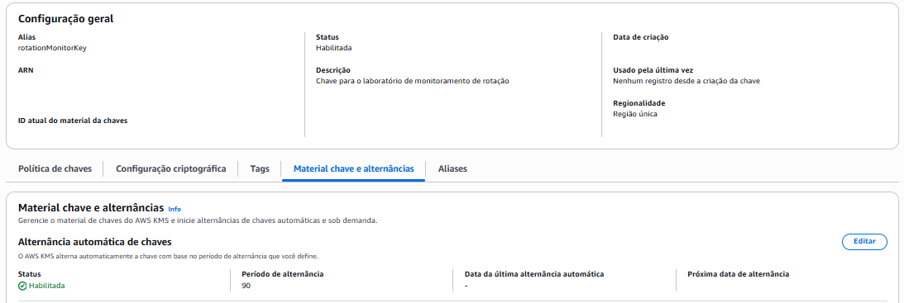

> O período de rotação automática aceita valores entre 90 e 2.560 dias (padrão de 365). O mínimo de 90 dias significa que uma rotação automática não dispara no tempo de um laboratório. A rotação automática fica ativada aqui para registrar a configuração, mas o evento monitorado nos testes vem da rotação sob demanda, que acontece na hora.

---

## Parte 2: Pré-requisito dos Dois Caminhos — Trilha do CloudTrail

Os dois caminhos dependem de uma trilha do CloudTrail ativa. Sem ela, o evento de rotação aparece no Event history do CloudTrail, mas não é entregue nem ao EventBridge nem ao CloudWatch Logs. O Event history mostra os eventos, mas não os encaminha para outros serviços.

A diferença entre os caminhos está no destino da trilha: o Caminho 1 (EventBridge) só precisa que a trilha exista; o Caminho 2 (CloudWatch) precisa que a trilha entregue os logs para um Log Group. Por isso, uma única trilha com entrega para o CloudWatch Logs atende aos dois, e por isso ela é configurada primeiro.

### Criar a trilha

1. Acessar **CloudTrail → Trilhas → Criar trilha**
2. Nome da trilha: `kms-rotation-trail`
3. Local de armazenamento: criar um novo bucket S3 (o console sugere um nome)
4. Criptografia SSE-KMS do arquivo de log: **desabilitada** (os logs já têm criptografia do S3; ativar SSE-KMS exigiria uma chave dedicada, fora do escopo deste lab)
5. **CloudWatch Logs: habilitado** — criar o Log Group `aws-cloudtrail-logs-kms-rotation` e a role de entrega
6. Clicar em **Próximo**

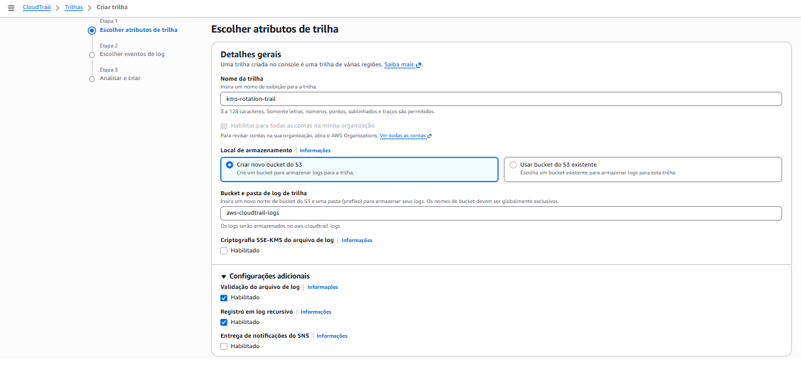

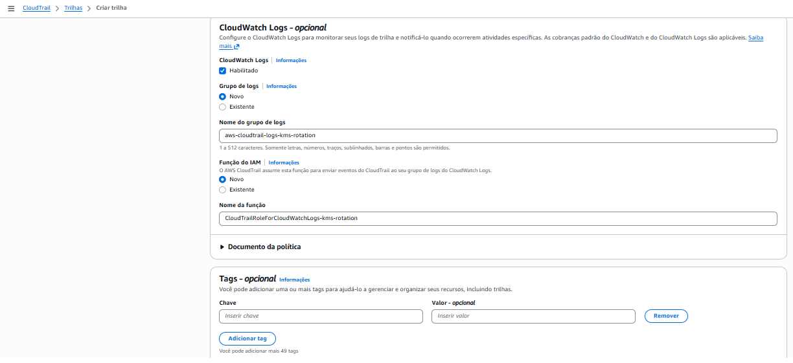

> A opção **Entrega de notificações do SNS** não deve ser marcada. Ela avisa sobre a entrega de arquivos de log no S3 e não tem relação com o tópico de alerta de rotação (`kms-rotation-alerts`). São dois usos diferentes de SNS no laboratório.

### Escolher os eventos

1. Tipo de evento: **Eventos de gerenciamento**
2. Atividade da API: **Leitura** e **Gravação**
3. **Não marcar "Excluir eventos do AWS KMS"**
4. Concluir a criação

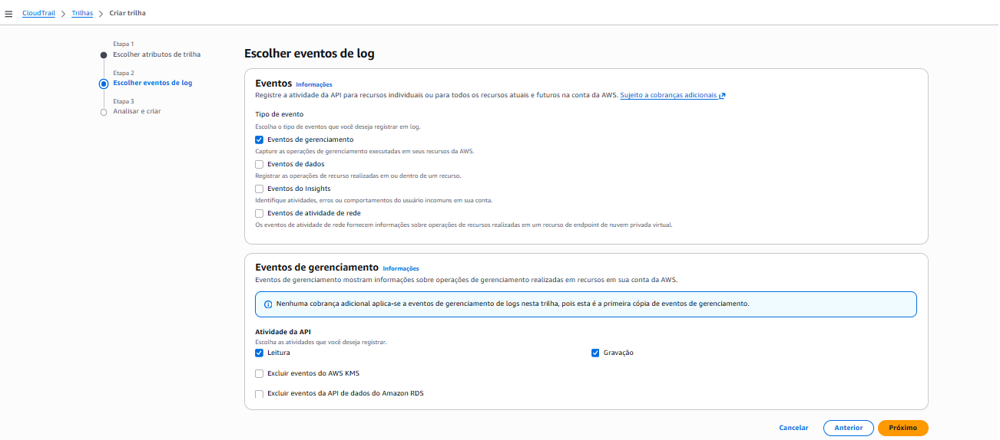

> Atenção à opção **Excluir eventos do AWS KMS**. Se marcada, a trilha para de registrar os eventos do KMS, incluindo o `RotateKeyOnDemand`, que é exatamente o que o laboratório monitora. Deve ficar desmarcada.

---

## Parte 3: Alertas em Tempo Real com EventBridge (Caminho 1)

Neste caminho, uma regra do EventBridge captura o evento de rotação e encaminha uma notificação para um tópico SNS, que a entrega por email. Começo pelo tópico SNS, que é o destino da notificação, para depois apontar a regra do EventBridge para ele.

### Criar o tópico SNS

1. Acessar **Amazon SNS → Tópicos → Criar tópico**
2. Tipo: **Standard** (o tipo FIFO não suporta entrega por email)
3. Nome: `kms-rotation-alerts`
4. Deixar o **Nome de exibição** em branco (só é usado para SMS)
5. Clicar em **Criar tópico**

---

### Assinar o tópico por email

1. No tópico `kms-rotation-alerts`, clicar em **Criar assinatura**
2. Protocolo: **Email**
3. Endpoint: o endereço de email que vai receber os alertas
4. Clicar em **Criar assinatura**

A assinatura fica com status **Pendente de confirmação** até ser confirmada. O SNS envia um email com um link de confirmação:

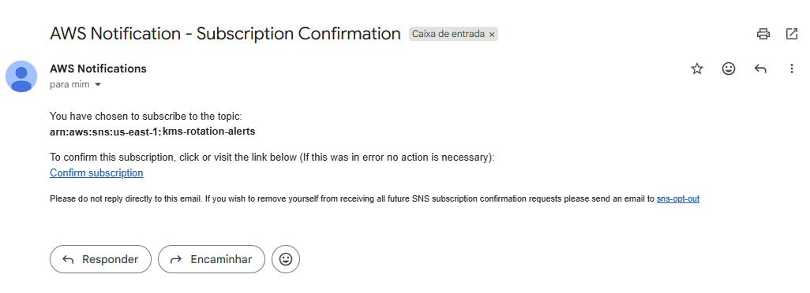

Ao clicar em **Confirm subscription**, o SNS confirma a assinatura:

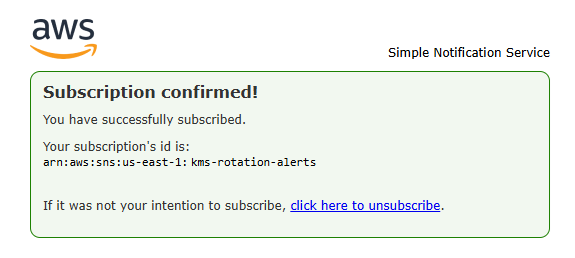

> A confirmação por email é uma proteção do SNS: sem ela, ninguém consegue inscrever um endereço de terceiros para receber mensagens sem consentimento. Enquanto a assinatura estiver pendente, nenhuma notificação é entregue.

---

### Criar a regra do EventBridge

O EventBridge tem uma interface própria, diferente da maioria dos serviços: um criador visual onde se conectam os eventos de origem aos destinos. À esquerda ficam os serviços que geram eventos; no centro, o fluxo entre o evento e o destino.

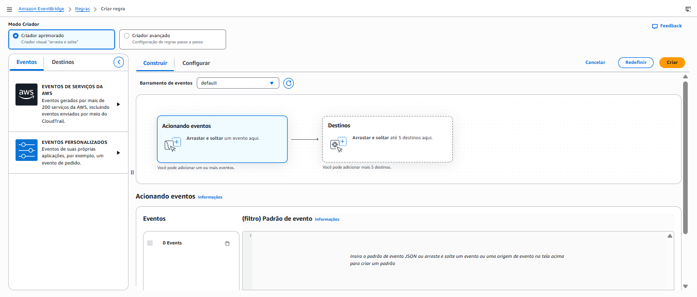

#### Selecionar o evento de origem (KMS)

1. Acessar **Amazon EventBridge → Regras → Criar regra**
2. Barramento de eventos: **default**
3. Em **Acionando eventos**, buscar e selecionar **Key Management Service (KMS)**
4. Tipo de evento: **AWS API Call via CloudTrail**

Só isso captura qualquer chamada de API do KMS. Para filtrar apenas a rotação, refino o padrão de evento pela opção **Padrão de evento (filtro)**, editando o JSON:

```json
{
  "source": ["aws.kms"],
  "detail-type": ["AWS API Call via CloudTrail"],
  "detail": {
    "eventName": ["RotateKeyOnDemand"]
  }
}
```

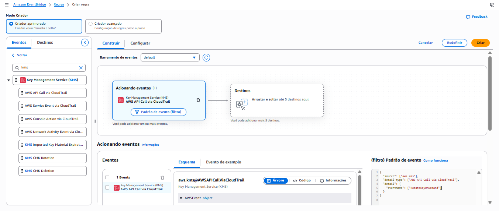

> O filtro por `eventName` é o que restringe a regra à rotação sob demanda. Sem ele, a regra dispararia a cada operação do KMS (encrypt, decrypt, describe), gerando ruído. A rotação automática, quando ocorre, gera um evento diferente (`RotateKey`), capturável pelo tipo dedicado **KMS CMK Rotation**.

#### Definir o destino (tópico SNS)

1. Na aba **Destinos**, selecionar **Tópico do SNS**
2. Local de destino: **Destino nesta conta**
3. Tópico: `kms-rotation-alerts`
4. Perfil de execução: **Criar perfil padrão**

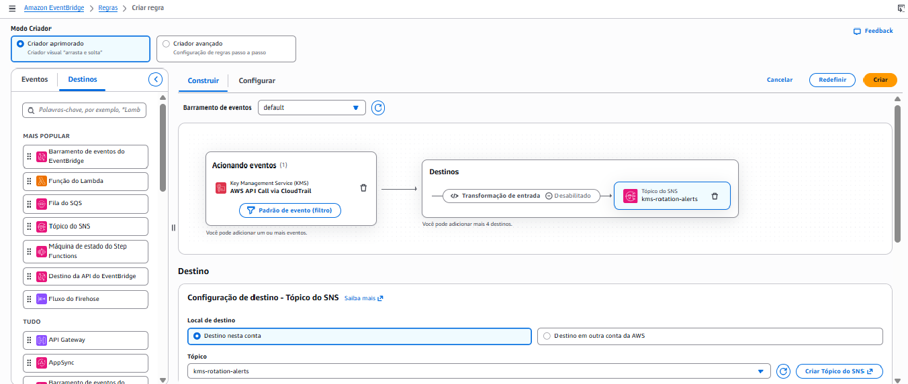

O EventBridge cria automaticamente uma role de execução (`Amazon_EventBridge_Invoke_Sns_...`) com permissão apenas para publicar nesse tópico. Não é preciso configurar IAM manualmente.

As opções de política de repetição e fila de mensagens não entregues podem ficar nos valores padrão:

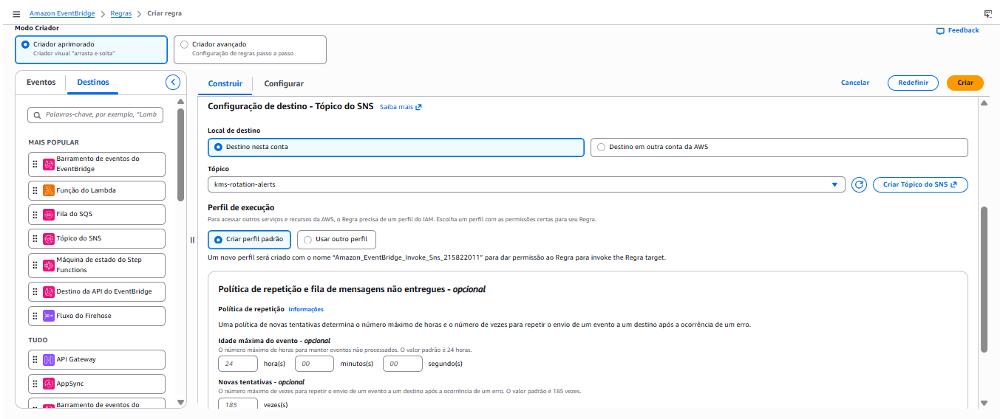

> A role criada segue o princípio do menor privilégio: seu escopo é apenas invocar o tópico SNS de destino, nada além disso.

#### Finalizar

1. Na aba **Configurar**, definir o nome: `kms-rotation-monitor-rule`
2. Manter a regra **Ativa**
3. Clicar em **Criar**

---

## Parte 4: Auditoria e Alertas por Métricas com CloudWatch (Caminho 2)

Neste caminho, um metric filter conta as ocorrências do evento de rotação nos logs e um alarme dispara quando a contagem cruza um limite. Diferente do EventBridge, esta abordagem gera uma métrica de verdade, o que permite acompanhar tendência e definir thresholds.

### Criar o Metric Filter

Primeiro, é preciso chegar até o Log Group da trilha:

1. Acessar **CloudWatch**
2. No menu lateral, em **Logs**, clicar em **Gerenciamento de logs**
3. Na busca, digitar `aws-cloudtrail-logs-kms-rotation`
4. Clicar no grupo de logs para abri-lo
5. Selecionar a aba **Filtros de métrica** e clicar em **Criar filtro de métrica**

Depois, definir o padrão:

6. **Padrão de filtro:**

```
{ $.eventName = "RotateKeyOnDemand" }
```

7. Deixar **Critérios de seleção de campo** em branco (só se aplica a grupos de logs centralizados multi-conta)
8. Clicar em **Próximo**

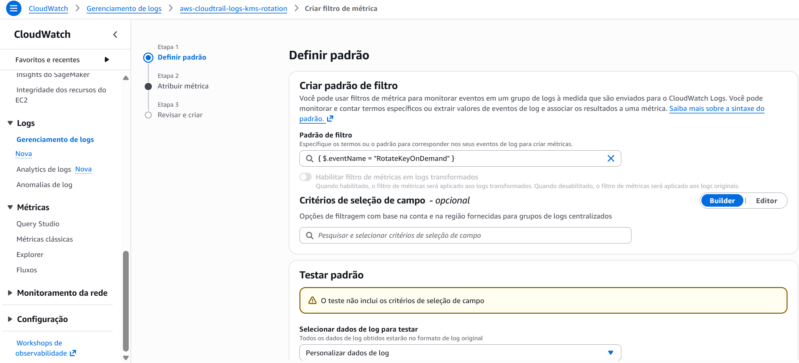

> O teste de padrão do console avalia um log stream por vez. Se o evento de rotação estiver em outro stream, o teste retorna vazio mesmo com o padrão correto. A validação confiável é aplicar o padrão ao Log Group inteiro via CLI:
>
> ```bash
> aws logs filter-log-events \
>   --log-group-name aws-cloudtrail-logs-kms-rotation \
>   --filter-pattern '{ $.eventName = "RotateKeyOnDemand" }' \
>   --region us-east-1
> ```

Configurar a métrica:

1. Nome do filtro: `kms-rotation-filter`
2. Namespace da métrica: `KMSMonitoring`
3. Nome da métrica: `KMSKeyRotationCount`
4. Valor da métrica: `1`
5. **Valor padrão: `0`**
6. Não adicionar dimensões
7. Revisar e criar

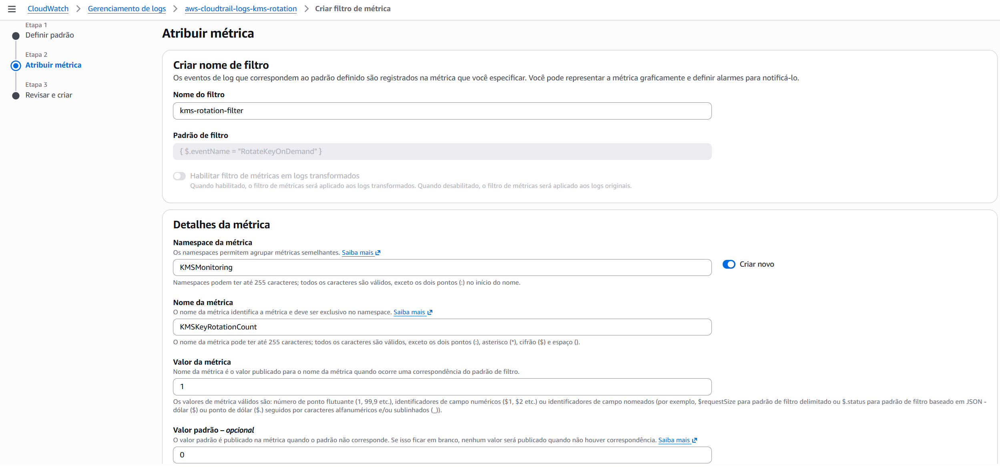

> O **valor padrão 0** e a **ausência de dimensões** são intencionais. Métricas de metric filter com dimensão só publicam pontos quando o filtro casa um evento, o que anula o valor padrão e deixa a série sem dados nos períodos sem rotação. Sem dimensão e com valor padrão 0, a métrica reporta uma série contínua, o que torna a avaliação do alarme estável.

### Criar o Alarme

O alarme é criado a partir da métrica que o filtro gerou. Para chegar até ela:

1. Na página do grupo de logs, abrir a aba **Filtros de métrica**
2. No filtro `kms-rotation-filter`, clicar no link do campo **Métrica** (`KMSMonitoring`). Uma nova aba abre no console de métricas do CloudWatch

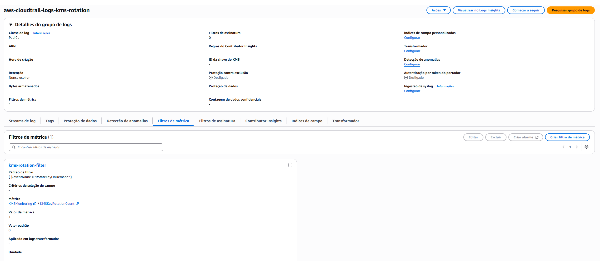

3. Clicar em **Métricas sem dimensões**
4. Marcar a caixa da métrica `KMSKeyRotationCount`. No canto direito, clicar em **Criar alarme**

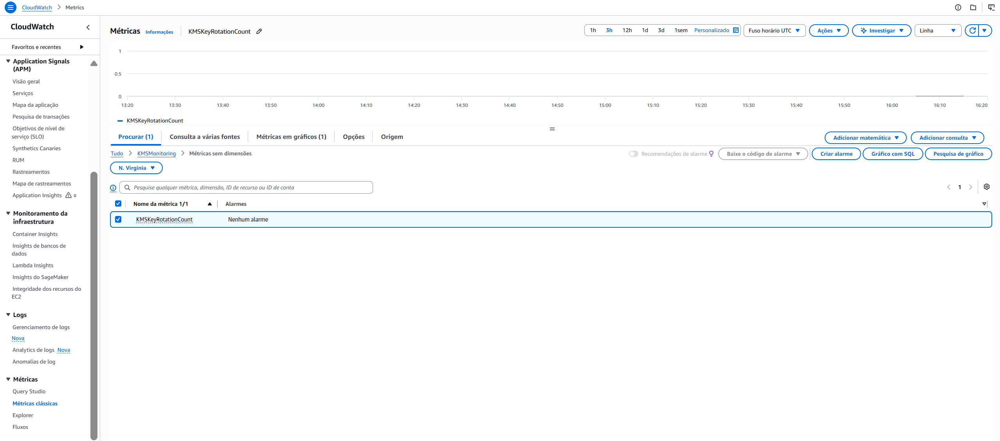

O console conduz a criação do alarme em quatro etapas: especificar a métrica e as condições, configurar ações, adicionar detalhes e revisar.

#### Etapa 1: Métrica e condições

1. Estatística: **Soma**
2. Período: **1 minuto**
3. Tipo de limite: **Estático**
4. Condição: **Maior/igual** a `1`

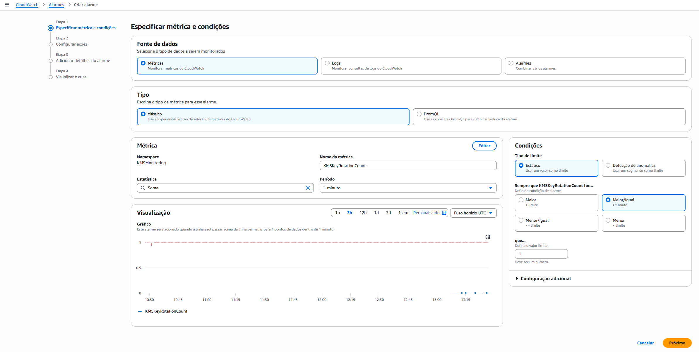

#### Etapa 2: Configurar ações

1. Em **Notificação**, selecionar o estado **Em alarme**
2. Em **Enviar uma notificação para o seguinte tópico do SNS**, escolher **Selecionar um tópico do SNS existente**
3. Selecionar o tópico `kms-rotation-alerts`
4. O campo **E-mail (endpoints)** mostra o email já inscrito no tópico

#### Etapa 3: Adicionar detalhes

1. Nome do alarme: `kms-rotation-alarm`
2. Descrição (opcional): descrever o que o alarme monitora, por exemplo, a rotação da `rotationMonitorKey`

#### Etapa 4: Visualizar e criar

Revisar as configurações e concluir.

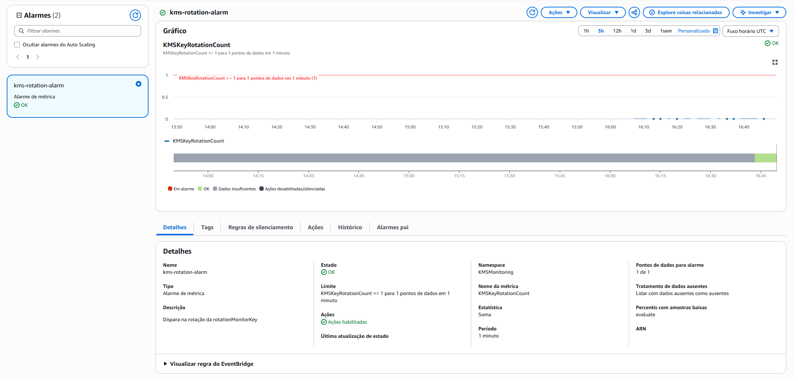

> Ao ser criado, o alarme passa por `INSUFFICIENT_DATA` e depois vai para `OK`, quando a métrica reporta 0. Só muda para `In alarm` após uma rotação, quando a métrica registra 1. Essa progressão de estados é normal.

---

## Testes

Os testes que disparam a rotação e validam as notificações dos dois caminhos estão no doc de [testes](04-testes.md).

---

## Referências

- [Monitoring KMS keys](https://docs.aws.amazon.com/kms/latest/developerguide/monitoring-overview.html)
- [Enable automatic key rotation](https://docs.aws.amazon.com/kms/latest/developerguide/rotating-keys-enable.html)
