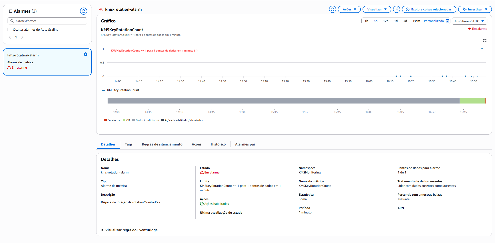

# 🧪 Testes e Validação

Este documento reúne os testes que provam o funcionamento dos dois caminhos de monitoramento. O gatilho comum é a rotação sob demanda da chave `rotationMonitorKey`, disparada pelo **AWS CloudShell**, que gera o evento `RotateKeyOnDemand` no CloudTrail.

> A rotação sob demanda exige o Key ID (ou ARN), não aceita alias. Resolver o alias antes com `describe-key`:
>
> ```bash
> aws kms describe-key --key-id alias/rotationMonitorKey --query KeyMetadata.KeyId --output text --region us-east-1
> ```

---

## Teste 1: Alertas em Tempo Real com EventBridge (Caminho 1)

**Objetivo:** Confirmar que uma rotação sob demanda gera uma notificação por email, de ponta a ponta.

Disparar a rotação (usando o Key ID):

```bash
aws kms rotate-key-on-demand --key-id <INSIRA_O_KEY_ID> --region us-east-1
```

A cadeia que se segue é: rotação → CloudTrail registra o evento → EventBridge captura pelo filtro → SNS publica → email entregue.

**Evidência (email recebido, transcrição resumida):**

```json
{
  "detail-type": "AWS API Call via CloudTrail",
  "source": "aws.kms",
  "region": "us-east-1",
  "detail": {
    "eventName": "RotateKeyOnDemand",
    "eventSource": "kms.amazonaws.com",
    "eventCategory": "Management",
    "requestParameters": { "keyId": "<INSIRA_O_KEY_ID>" }
  }
}
```

**Resultado:** ✅ O email chegou com o payload do evento `RotateKeyOnDemand`, confirmando a cadeia completa.

> O corpo real do email traz campos sensíveis (Account ID, identidade IAM, IP de origem, ARNs). A transcrição acima foi reduzida e mascarada para o portfólio. É o mesmo cuidado aplicado no Lab 02 com telas do CloudTrail.

> **Latência:** o email deste caminho chega quase imediatamente após a rotação. O EventBridge reage evento a evento, sem etapa de agregação, o que o torna mais rápido que o Caminho 2.

---

## Teste 2: Auditoria e Alertas por Métricas com CloudWatch (Caminho 2)

**Objetivo:** Confirmar que a rotação incrementa a métrica `KMSKeyRotationCount` e faz o alarme mudar de `OK` para `In alarm`.

Disparar a rotação (mesmo comando do Teste 1):

```bash
aws kms rotate-key-on-demand --key-id <INSIRA_O_KEY_ID> --region us-east-1
```

A cadeia neste caminho é: rotação → CloudTrail → Log Group → metric filter incrementa a métrica → alarme avalia e cruza o limite → SNS envia o email.

O alarme muda de `OK` para `In alarm`, e o gráfico mostra a métrica cruzando o limite:



**Evidência (email do alarme, transcrição resumida):**

```
Alarm "kms-rotation-alarm" entered the ALARM state.
Reason: Threshold Crossed: 1 datapoint [1.0] was greater than or equal to the threshold (1.0).
State Change: OK -> ALARM
Metric: KMSMonitoring / KMSKeyRotationCount (Statistic: Sum, Period: 60s)
```

**Resultado:** ✅ A métrica subiu para 1, o alarme cruzou o limite (`>= 1`) e mudou de `OK` para `ALARM`, disparando o email pelo SNS.

> O email real traz Account ID e ARNs. A transcrição acima foi reduzida para o portfólio.

> **Latência:** o alarme do Caminho 2 demora mais que o email do Caminho 1. Em um teste, o alarme disparou cerca de 2,5 minutos após a rotação. Isso se deve à agregação em métrica e à janela de avaliação de 1 minuto, etapas que o Caminho 1 não tem.

---

## Comparação dos Dois Caminhos

Com os dois caminhos validados, a diferença prática fica clara:

| Critério | Caminho 1 (EventBridge + SNS) | Caminho 2 (CloudWatch + Alarme) |
|----------|:-----------------------------:|:-------------------------------:|
| Latência | Quase imediata | ~2,5 min (medido) |
| Gera métrica/histórico | Não | Sim |
| Permite threshold por volume | Não | Sim |
| Passos de configuração | Menos | Mais |

A análise completa, com os cenários de uso de cada abordagem, está no doc de [arquitetura](02-arquitetura.md).
